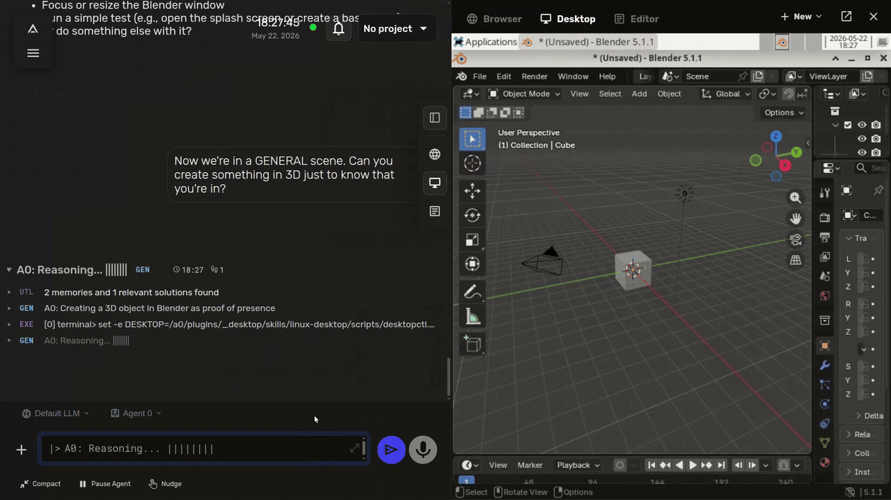
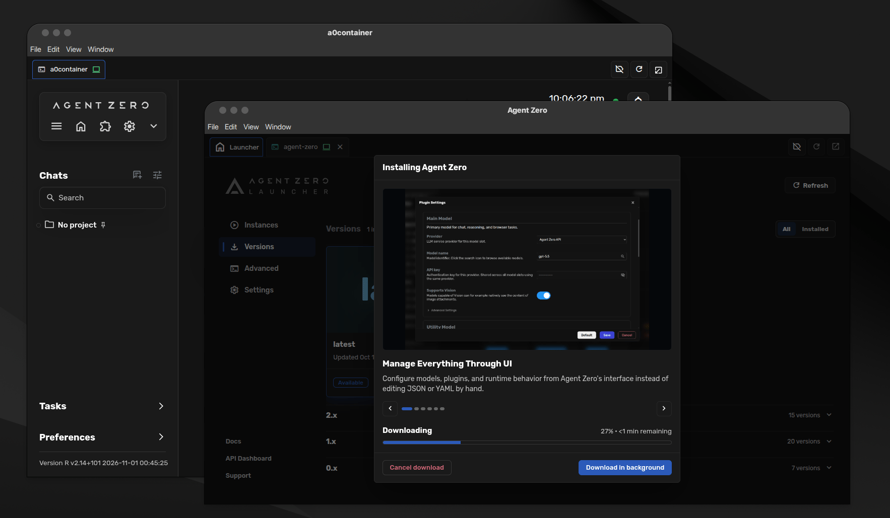
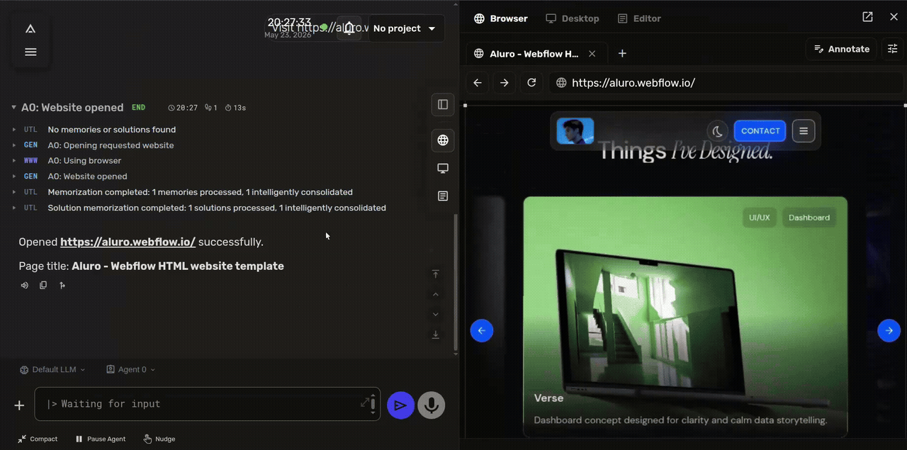
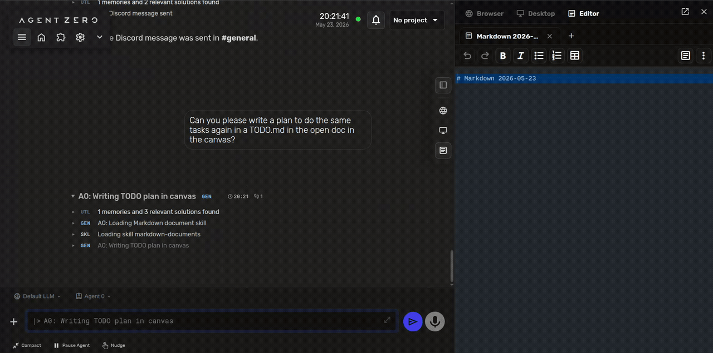
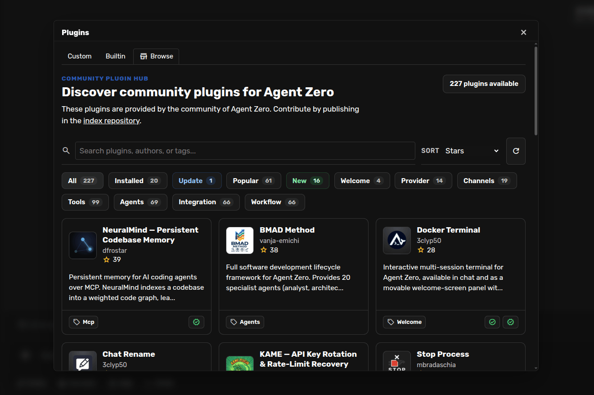
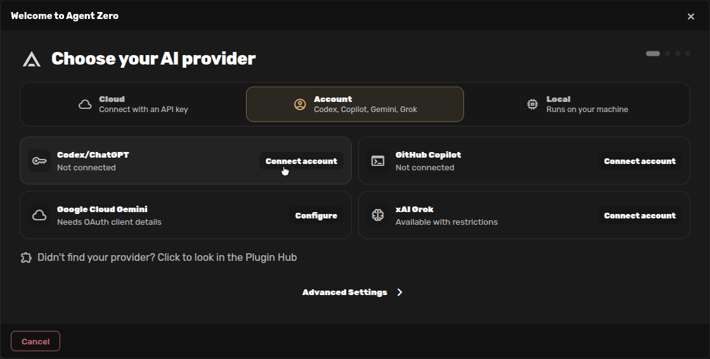
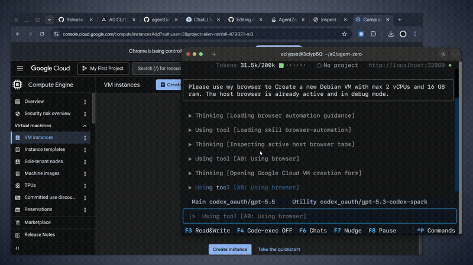

<div align="center">


# Agent Zero
### Give your agent a full Linux computer.

Agent Zero is an open-source AI agent with its own Linux workspace. It can research, write code, create and work with documents using a terminal, browser, and desktop apps. It runs in a sandbox, but you can step in, and connect it to local files on your own computer when needed.

**[Get started](#quick-start)** · [Installation guide](https://www.agent-zero.ai/p/docs/installation/#installation)

[](https://agent-zero.ai)
[](./docs/)
[](https://discord.gg/B8KZKNsPpj)
[](https://github.com/sponsors/agent0ai)
[](https://deepwiki.com/agent0ai/agent-zero)

[Quick Start](#quick-start) |
[Why Agent Zero](#why-agent-zero) |
[Try These First](#try-these-first) |
[Deep Dives](#deep-dives) |
[Docs](#documentation)

</div>

<div align="center">

</div>

# Quick Start

Choose **[A0 Launcher](#desktop-setup)** for a desktop computer, or **[A0 Install](#servers-and-shell-access)** for a server or shell-only environment.

You will need a supported AI account, a provider API key, or a local model server to start chatting.

<a id="recommended-a0-launcher"></a>

## Desktop setup

<p align="center">

</p>

**A0 Launcher is recommended for desktop computers.** It guides you through Docker setup, creates your Agent Zero instance, and opens the Web UI.

**Download A0 Launcher v1.9** for your operating system and processor:

| Platform | Recommended download | Other processors |
| --- | --- | --- |
| Windows | **[Windows x64](https://github.com/agent0ai/a0-launcher/releases/download/v1.9/a0-launcher-1.9-windows-x64.exe)** · Intel / AMD | [Windows ARM64](https://github.com/agent0ai/a0-launcher/releases/download/v1.9/a0-launcher-1.9-windows-arm64.exe) |
| macOS | **[Apple Silicon](https://github.com/agent0ai/a0-launcher/releases/download/v1.9/a0-launcher-1.9-macos-arm64.dmg)** · M-series Macs | [Intel Macs only](https://github.com/agent0ai/a0-launcher/releases/download/v1.9/a0-launcher-1.9-macos-x64.dmg) |
| Linux | **[Linux x64](https://github.com/agent0ai/a0-launcher/releases/download/v1.9/a0-launcher-1.9-linux-x64.AppImage)** · Intel / AMD | [Linux ARM64](https://github.com/agent0ai/a0-launcher/releases/download/v1.9/a0-launcher-1.9-linux-arm64.AppImage) |

1. **Open Launcher** and follow any Docker setup prompt.
2. **Create an Instance**, a separate Agent Zero setup. Choose **Download Agent Zero** or **Run Agent Zero**, keep the default version and persistent workspace, then click **Create**. Wait for **Running** and click **Open UI**.

Continue with [your first message](#send-your-first-message), or see the [Installation guide](./docs/setup/installation.md) for screenshots and help.

<a id="a0-install"></a>

## Servers and shell access

**A0 Install is recommended when you have shell access but no graphical desktop**, such as a server or an SSH session. It runs interactively in your terminal, helps set up Docker where needed, and creates an Agent Zero instance with a persistent workspace.

### macOS / Linux

```bash
curl -fsSL https://bash.agent-zero.ai | bash
```

### Windows PowerShell

```powershell
irm https://ps.agent-zero.ai | iex
```

Follow the prompts, then open the Web UI and [send your first message](#send-your-first-message). For a local install, use the printed URL. On a remote server, `localhost` refers to that server; follow the [VPS guide](./docs/setup/vps-deployment.md) for access and authentication before connecting from a browser on your own computer.

<a id="headless--scripted"></a>

For setup without installer menus, see [scripted installation](./docs/setup/installation.md#headless--scripted) and the [full installer options](https://github.com/agent0ai/a0-install).

## Send your first message

1. **Send a message** from the welcome screen. Try: "Create a one-page plan for a 15-minute team kickoff. Save it as a Markdown file and give me a link."
2. **Connect a model** when the chat asks. Choose **Cloud provider**, **AI account**, or **Local model**, then select a **Main model** for conversations and a **Utility model** for summaries and chat names. They can use the same provider.
3. Click **Finish setup**, then **Continue** to close setup. Your original message resumes in the same chat; watch for the reply and open the returned file link.

The [Codex guide](./docs/guides/codex.md) covers ChatGPT account sign-in. If your provider is missing, use the provider-plugin link to find it in the Hub; the [OpenCode Go guide](./docs/guides/opencode.md) walks through installation.

<details>
<summary><strong>Other install options</strong></summary>

## Docker already installed? Run this directly

```bash
docker run -d -p 127.0.0.1:5080:80 -v a0_usr:/a0/usr agent0ai/agent-zero
```

Open `http://localhost:5080` on the Docker host, then [send your first message](#send-your-first-message). The `a0_usr` volume keeps your data when the container is replaced. Keep backups too. This command makes the Web UI available only on the Docker host; see the [Installation guide](./docs/setup/installation.md) for other setups.

## Troubleshooting

- **Docker is not running:** start Docker Desktop or your Docker service, then reopen the Launcher or rerun the install command.
- **Linux download won't open:** allow the AppImage to run as a program in its file properties, then open it again.
- **Port is already in use:** choose another in Launcher or A0 Install. For the Docker command above, replace `5080` with a free port and use that port in your browser URL.
- **No first reply:** check that setup finished and both models are available through your chosen provider. Read any connection or account error shown in the chat.
- **Still blocked:** see the [Troubleshooting guide](./docs/guides/troubleshooting.md).

</details>

# Try These First

- **Make a plan:** "Create a one-page plan for a 15-minute team kickoff, with a goal, three agenda items, and next steps. Save it as a Markdown file and give me a link."
- **Work with a document:** attach a document, then ask, "Summarize the main points and list anything I need to follow up on."
- **Research a topic:** "Compare three places for a weekend trip by train from Rome. Link your sources and make a shortlist."

Once you are comfortable, try the Browser and Desktop:

- **Annotate a design you like:** "Open this site in the Browser. I'll point out the parts I like, then help me build something similar for my project."
- **Cowork on a spreadsheet:** "Create an editable ODS budget model with assumptions and monthly projections."
- **Drive a desktop app:** "Use the Linux Desktop to open Blender and create a simple 3D logo for me."
- **Review a web UI:** "Open my local app in the Browser. I will annotate the page with comments; then implement the requested UI fixes."

## Coming from another agent?

Bring chats from **Pi, Hermes Agent, or Claude Code** into Agent Zero with [Migrate Agents](./docs/guides/migrate-agents.md). Preview the import before saving it, then continue the conversation here. Project files are copied separately; importing a chat does not move its workspace.

# Why Agent Zero

| What you can do | Where to start |
| --- | --- |
| Use desktop apps and work on documents together | [Desktop and Cowork](./docs/guides/desktop.md) |
| Browse the web and point out exactly what needs changing | [Browser and annotations](./docs/guides/browser.md) |
| Keep each job's files, instructions, and memory together | [Projects](./docs/guides/projects.md) |
| Add providers, tools, and integrations | [Plugin Hub](https://www.agent-zero.ai/p/docs/plugins/#plugin-hub) |
| Work on files on your own computer | [Launcher Host access](./docs/guides/launcher.md#host-access), or [A0 CLI](./docs/guides/a0-cli-connector.md) |
| Adapt the agent to how you work | [Agent Profiles](./docs/guides/agent-profiles.md) and [Skills](./docs/guides/skills.md) |

# Deep Dives

## A Real Linux Desktop in the Canvas

The **Canvas** is the panel beside your chat for browsers, documents, and the desktop. Open **Desktop** there to see Agent Zero's Linux workspace. It can use Blender, a terminal, a file manager, and other desktop apps. You can watch and take over with your own mouse and keyboard.

See the [Desktop guide](./docs/guides/desktop.md) for the walkthrough, prompt examples, and how Desktop differs from Browser.

<a id="native-browser-with-dom-annotations"></a>

## Browse and Annotate


<br>

The built-in Browser opens pages, fills forms, uploads files, and takes screenshots. Open it in the Canvas to follow along. In **Annotate** mode, click a page element to inspect it, request a change, capture a design reference, or leave a comment for the agent.

Browser history keeps screenshots of important steps. You can also install Chrome extensions or connect a browser on your own computer through Launcher Host access or A0 CLI.

See the [Browser guide](./docs/guides/browser.md) for screenshots, settings, host-browser setup, and troubleshooting.

## Cowork on Documents

### Markdown Editor With Live Cowork


<br>

Ask Agent Zero to write a plan or meeting notes as a Markdown file, then open it in the Canvas editor. You can type, format text, and edit tables while the agent works on the same document.

### LibreOffice Integration

Use the Desktop toolbar to create a Writer document, spreadsheet, or presentation. Agent Zero can work on these LibreOffice files alongside you and save the result as ODT, ODS, or ODP.

<a id="plugin-hub---100-community-plugins"></a>

## Plugin Hub


<br>

Open the **Plugin Hub** to find community providers, tools, memory systems, integrations, and UI additions. Read a plugin's description and setup instructions before installing it. You can also build and publish your own.

See the [Plugin Hub guide](https://www.agent-zero.ai/p/docs/plugins/#plugin-hub), the [Create a Small Plugin](./docs/guides/create-plugin.md) tutorial, and the [MCP setup](./docs/guides/mcp-setup.md) guide for connecting external tools.

## Use Codex with Your ChatGPT Account


<br>

Sign in with your ChatGPT account, choose Codex models, and continue in Agent Zero. Enable device code sign-in in ChatGPT, open **Account** in Agent Zero's onboarding, and connect **Codex/ChatGPT**. After you authorize on OpenAI's page and choose Main and Utility models, your first message resumes in the same chat.

Follow the [Codex account setup guide](./docs/guides/codex.md) for the complete walkthrough with screenshots.

## A0 CLI Connector: Extend Onto Your Host Machine


<br>

The **A0 CLI Connector** connects your terminal to a running Agent Zero instance. It can give the agent access to files, commands, and a browser on your own computer.

Using Launcher? Its optional **Host access** controls manage the supporting CLI for you. Follow the [Host access guide](./docs/guides/launcher.md#host-access) to choose what to allow. Install A0 CLI yourself when you want to chat from a terminal or connect another computer.

Install the connector on the machine you want Agent Zero to work on, **not** inside the Agent Zero container.

### macOS / Linux

```bash
curl -LsSf https://cli.agent-zero.ai/install.sh | sh
```

### Windows PowerShell

```powershell
irm https://cli.agent-zero.ai/install.ps1 | iex
```

Then run `a0` to connect your terminal to an existing Agent Zero instance. It can usually discover a local instance automatically, or you can point it at a remote URL hosted somewhere else, such as a VPS or tunnel.

For full setup, see the [A0 CLI Connector guide](https://www.agent-zero.ai/p/docs/a0-cli-connector/) (or the [in-repo guide](./docs/guides/a0-cli-connector.md)).

## Projects, Skills, Agent Profiles, and Model Presets

**Projects** isolate workspaces, instructions, memory, secrets, knowledge, repositories, and model-preset choices. Clone a public or private Git repo into a project and give the agent context that belongs to that work alone.

**Skills** can be loaded on demand by Agent Zero, or pinned from the chat input when you want a specific procedure to stay active.

**Agent Profiles** change the broader working style of the current chat.

**Model Presets** are named shortcuts for model setups, so you can quickly switch between fast, balanced, cheap, local, or high-power model choices.

## Multi-Agent Cooperation

Agent Zero can delegate parts of a task to other agents. Each works with its own instructions and conversation, then reports back. This can help divide research, coding, and review work.

## Transparent and Extensible by Design

Almost nothing is hidden. Prompts live in `prompts/`, tools live in `tools/` or plugins, and built-in behavior can be inspected, changed, replaced, or extended.

You can add tools through plugins or MCP, connect other agents through A2A, and give each project its own instructions and settings. See [DeepWiki](https://deepwiki.com/agent0ai/agent-zero) for how the parts fit together.

## Time Travel

Time Travel keeps snapshots of Agent Zero's workspace under `/a0/usr`. See what changed, compare files, inspect a past state, and roll back when needed.


It is not a replacement for Git or backups. It is a practical safety layer for the workspace where agents are actively creating and editing files.

## Real-World Use Cases

- **Software engineering:** inspect a codebase, make scoped edits, run tests, explain tradeoffs, and keep a recoverable history of file changes.
- **Local development:** use Launcher Host access or `a0` to work in a local repository, or clone it into an Agent Zero project.
- **Design inspiration and UI iteration:** browse the web, annotate elements you like, and pull components into your own stack.
- **Financial analysis and charting:** collect data, correlate events, create spreadsheets, and generate editable charts.
- **Office deliverables:** cowork on documents, spreadsheets, and presentation decks instead of trapping the result in chat text.
- **Web and mobile QA:** browse an app, annotate UI issues, install browser extensions, and turn visual comments into actionable fixes.
- **API integration:** paste an API snippet, let the agent build a working example, and store the pattern for future use.
- **Client/project isolation:** keep memory, secrets, instructions, files, and model choices separated by project.
- **Scheduled operations:** run recurring checks and monitoring tasks with project-scoped context and credentials.

## Documentation

| I want to... | Start here |
| --- | --- |
| Install or update Agent Zero | [Installation](./docs/setup/installation.md) |
| Learn the UI and basic workflow | [Quickstart](./docs/quickstart.md) |
| Connect your ChatGPT account and use Codex models | [Codex account setup](./docs/guides/codex.md) |
| Add OpenCode Go or another provider plugin | [OpenCode Go setup](./docs/guides/opencode.md) |
| Bring chats from Pi, Hermes, or Claude Code | [Migrate Agents](./docs/guides/migrate-agents.md) |
| Browse, annotate, and use Browser screenshots | [Browser guide](./docs/guides/browser.md) |
| Use the Linux desktop and LibreOffice | [Desktop guide](./docs/guides/desktop.md) |
| Work on files and run commands on my computer | [Launcher Host access](./docs/guides/launcher.md#host-access) or [A0 CLI](./docs/guides/a0-cli-connector.md) |
| Use projects and Git workspaces | [Projects guide](./docs/guides/projects.md) |
| Create a small plugin | [Create a Small Plugin](./docs/guides/create-plugin.md) |
| Add or remove active skills | [Skills guide](./docs/guides/skills.md) |
| Create or switch Agent Profiles | [Agent Profiles](./docs/guides/agent-profiles.md) |
| Create or switch Model Presets | [Model Presets](./docs/guides/model-presets.md) |
| Manage and curate memories | [Memory guide](./docs/guides/memory.md) |
| Learn the everyday chat controls | [Usage guide](./docs/guides/usage.md) |
| Configure MCP or external tools | [MCP setup](./docs/guides/mcp-setup.md) |
| Understand the architecture and internals | [DeepWiki for Agent Zero](https://deepwiki.com/agent0ai/agent-zero) |
| Build an advanced extension | [Extensions](./docs/developer/extensions.md) |
| Contribute to the project | [Contributing](./docs/guides/contribution.md) |
| Troubleshoot problems | [Troubleshooting](./docs/guides/troubleshooting.md) |

## Build With Us

Agent Zero is built for people who want to understand and shape their tools.

You can help by improving docs, creating skills, publishing plugins, testing model/provider setups, reporting bugs, sharing workflows, or contributing core improvements. Start with the [Contributing guide](./docs/guides/contribution.md), browse the [Plugin Hub](https://www.agent-zero.ai/p/docs/plugins/#plugin-hub), or bring ideas to Discord.

## Community and Support

- [Discord](https://discord.gg/B8KZKNsPpj) for live discussion and help.
- [Skool Community](https://www.skool.com/agent-zero) for community learning.
- [YouTube](https://www.youtube.com/@AgentZeroFW) for demos and tutorials.
- [X](https://x.com/Agent0ai), [LinkedIn](https://www.linkedin.com/company/109758317), and [Warpcast](https://warpcast.com/agent-zero) for updates.
- [GitHub Issues](https://github.com/agent0ai/agent-zero/issues) for bugs and feature requests.

[Space Agent](https://github.com/agent0ai/space-agent) is a related project from the Agent Zero team.

Agent Zero is available under the [MIT License](./LICENSE).

## Safety Model

Agent Zero is powerful because it can use a real environment.

- Keep it running inside Docker or another isolated environment.
- Do not mount your entire home directory unless you understand the risk.
- Give Launcher or A0 CLI permission to edit files and run commands only when you trust the connected Instance.
- Store credentials in project secrets or settings, not in prompts or public files.
- Review actions that touch accounts, money, production systems, or private data.
- Keep backups for important workspaces.
