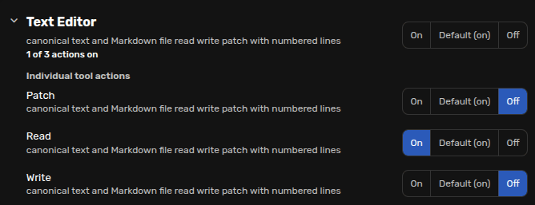
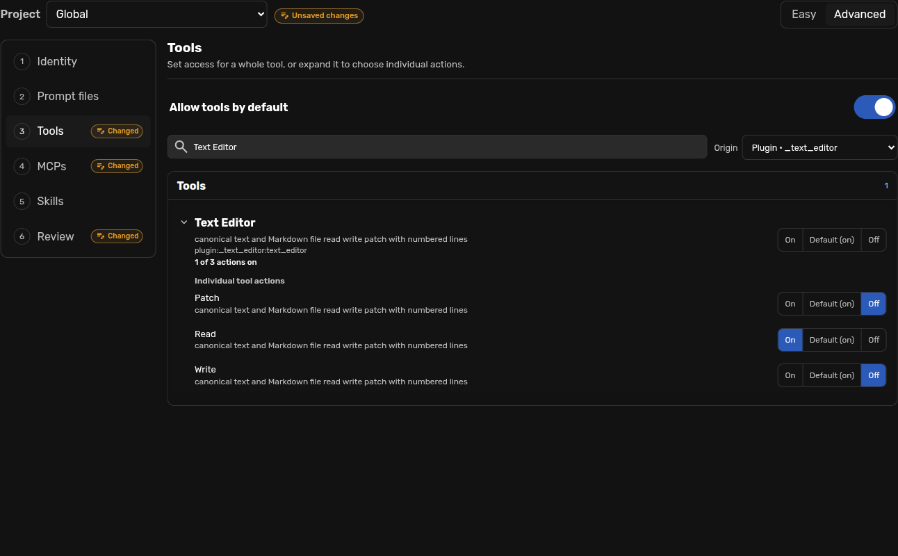
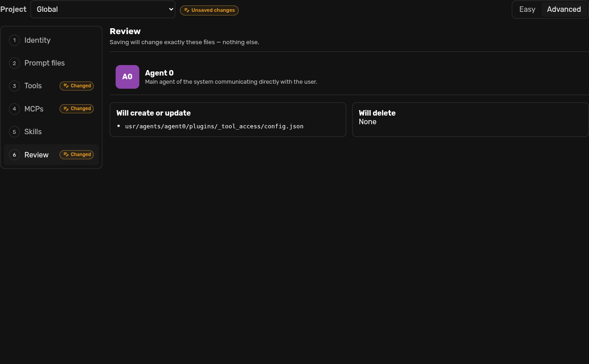
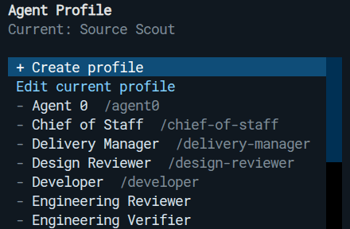
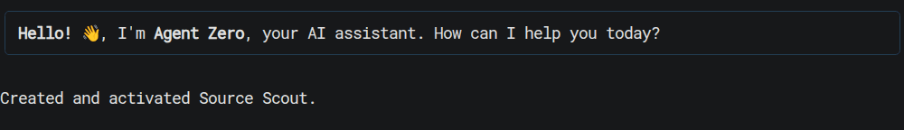
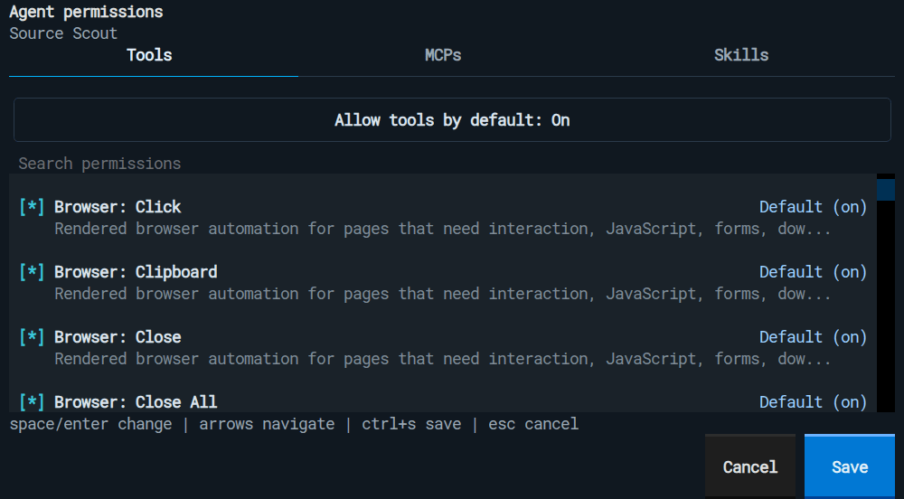

# Agent Profiles and the Agent Editor

Agent Profiles give a chat a repeatable role, set of instructions, model preset,
and capability policy. Use one when you want Agent Zero to work consistently as
a developer, researcher, reviewer, writer, or another specialist.

The Agent Editor is deterministic: it does not call a model to interpret your
changes. It writes only the profile overrides shown in its Review page and
leaves the bundled profiles under `/a0/agents` unchanged.

## Open the Agent Editor

The profile menu is beside the chat input.


- Select a profile name to use it in the current chat.
- Select **Edit** on a row to open that profile in Easy mode.
- Select **Manage agents** to create, duplicate, reset, delete, or change the
  availability of profiles.

Changing the selected profile affects only that chat. To choose the profile for
future Global chats, open **Settings → Agent → Agent Config**.

## Create or edit a profile in Easy mode

Open **Manage agents**, select **Create agent**, and complete the form:

1. Choose **Global** to make the profile available everywhere, or choose a
   project to keep the profile and its overrides in that project.
2. Enter the agent name. Agent Zero creates a stable profile ID from the name.
3. Optionally choose a color or image.
4. Select a model preset, or keep the current preset.
5. Write direct instructions: what the agent should do, how it should reason,
   and how it should communicate.
6. Review the capability defaults and any individual Tool, MCP, or Skill
   decisions.
7. Select **Create agent** or **Save changes**.


Creating a profile opens a fresh chat with the new profile selected. Editing an
existing profile also offers **Save & test**, which saves and opens a fresh chat
for testing without changing the old chat's history.

### Choose capability access

Easy mode has separate default switches and expandable lists for **Tools**,
**MCPs**, and **Skills**.



Each item has three states:

| State | Meaning |
| --- | --- |
| **On** | Explicitly allow this item for the profile. |
| **Default (on/off)** | Follow the category's **Allow ... by default** switch. |
| **Off** | Block this item for the profile. |

Changing a category default affects current and future items that remain on
**Default**. Explicit **On** and **Off** decisions stay pinned. Tools and MCPs
have separate defaults. Skills use their own visibility policy.

### Allow individual tool actions

Expand a tool's arrow to see **Individual tool actions**. For example, the text
editor can have **Read** allowed while **Write** and **Patch** are off. Each
action has its own On, Default, and Off choice.

The controls on the parent tool apply to **all** its actions, including actions
hidden by an Advanced search. Set the parent first, then adjust individual
actions. Expanding or searching a list does not change permissions.

These choices apply in the selected Global or project profile scope. Check
**Advanced → Review** before saving to see the exact changes.

> [!IMPORTANT]
> Tool permissions control those tool calls; they are not a filesystem sandbox.
> Allowing terminal execution can still let the agent read or write files even
> if the text editor's write action is off. Review the other allowed capabilities
> when you want a profile to work read-only.

> [!NOTE]
> Skill access controls discovery and new loading. It does not remove skill
> text that is already part of a chat's saved history.

## Manage existing profiles and project availability

**Manage agents** shows the active profile and every profile available to the
selected scope. Use the **Project** selector before making a change.


The row actions have distinct effects:

| Action | Effect |
| --- | --- |
| Availability toggle | Show or hide the profile for selection and delegation in the selected scope. |
| **Duplicate** | Create an independent copy with a new ID. |
| **Reset to default** | Remove overrides from the selected scope; bundled originals remain. |
| Edit icon | Open the profile in the selected scope. |
| Delete icon | Permanently delete a custom profile after confirmation. |

To stop a profile from being selected or delegated to in one project:

1. Open **Manage agents**.
2. Choose the project.
3. Turn that profile's availability toggle off.

The Global profile is not deleted or changed. Agent Zero keeps at least one
profile available in every scope; if a chat uses a profile that becomes
unavailable, it is reconciled to an available profile.

## Advanced mode

Select **Advanced** when you need more than the Easy form. The left navigation
separates six concerns:

1. **Identity** — title, description, profile ID, delegation guidance, image,
   and model preset.
2. **Prompt files** — edit individual inherited or customized Markdown prompt
   files in the ACE editor.
3. **Tools** — search local and plugin tools and set their access policy.
4. **MCPs** — set access independently for tools discovered from MCP servers.
5. **Skills** — control which installed skills the profile can discover and
   load.
6. **Review** — inspect the exact files that will be created, updated, or
   deleted before saving.

### Edit prompt files

Choose a prompt file on the left. The editor shows its effective source and the
sparse customization path. **Reset to default** removes only your override for
that file.


### Review explicit capability decisions

Advanced Tools, MCPs, and Skills use the same **On / Default / Off** semantics
as Easy mode, with search and origin filtering. Advanced mode can also show a
retained decision for an item that is not currently available, so you can clear
or change stale configuration.



### Review before saving

Review is the source of truth for the save. If a file is not listed, the editor
will not write or delete it.



For a built-in profile, **Remove my changes** deletes only the selected scope's
overrides. Full deletion is offered only for custom profiles.

## Use profiles from A0 CLI

The [A0 CLI Connector](a0-cli-connector.md) exposes the same profile and
permission owners.

```text
/profile
/profile Developer
/profile "Source Scout" "Verify every important claim and cite the source."
/permissions
```

- `/profile` opens the profile menu. Choose **Create profile** or **Edit current
  profile** for a compact two-step editor.
- `/profile Developer` selects an existing profile by name or ID.
- `/profile "<name>" "<instructions>"` creates a profile in the current chat's
  Global or project scope, then opens a fresh chat with it selected.
- `/permissions` edits Tools, MCPs, and Skills for the current profile. Each row
  cycles through **Default**, **On**, and **Off**; Tools and MCPs have independent
  defaults.

The CLI lists individual tool actions as separate rows. Use the Web UI's Agent
Editor when you prefer to expand them under their parent tool.







The CLI derives scope from the current chat. It intentionally has no separate
scope selector: a project chat edits that project, while a chat with no project
edits Global.

## Power-user file overrides

Prefer the Agent Editor because it validates changes and shows the exact save
plan. If you manage files directly, use the same sparse layout and formats.

| Scope | Writable profile root |
| --- | --- |
| Global | `/a0/usr/agents/<profile-id>/` |
| Project | `/a0/usr/projects/<project>/.a0proj/agents/<profile-id>/` |

Never edit the bundled `/a0/agents/<profile-id>` files for a customization.
Create only the files and keys you need to override.

```text
<profile-root>/
├── agent.yaml
├── prompts/
│   └── agent.system.main.specifics.md
└── plugins/
    ├── _model_config/config.json
    ├── _tool_access/config.json
    └── _skills/config.json
```

### Identity definition: YAML

Authored profile definitions use YAML. A missing key inherits; an explicitly
empty value clears that field.

```yaml
title: Source Scout
description: Researches technical claims and returns concise evidence.
context: Use this agent for source discovery and claim verification.
```

### Prompt overrides: Markdown

Place a Markdown file under `prompts/` with the same filename as the prompt you
want to replace. Do not copy the whole prompt tree. For example:

```text
prompts/agent.system.main.specifics.md
```

The Agent Editor's Prompt files page is the easiest way to discover available
filenames and the exact customization path. See the
[Prompts guide](https://www.agent-zero.ai/p/docs/prompts/) for the
prompt-loading model.

### Tool and MCP policy: JSON

Runtime and editor-written configuration uses JSON. Tools and MCPs share
`plugins/_tool_access/config.json`, but have independent defaults:

```json
{
  "mode": "custom",
  "default": "allow",
  "mcp_default": "block",
  "allowed": [
    "local:call_subordinate",
    "mcp:deep_wiki:ask_question"
  ],
  "blocked": [
    "plugin:_code_execution:code_execution_tool"
  ]
}
```

Canonical IDs use these forms:

| Source | ID form | Example |
| --- | --- | --- |
| Core/local tool | `local:<tool>` | `local:call_subordinate` |
| Plugin tool | `plugin:<plugin-id>:<tool>` | `plugin:_code_execution:code_execution_tool` |
| Bundled tool action | `plugin:<plugin-id>:<tool>:<action>` | `plugin:_text_editor:text_editor:read` |
| MCP tool | `mcp:<server>:<tool>` | `mcp:deep_wiki:ask_question` |

An ID in `allowed` is **On**; an ID in `blocked` is **Off**; an ID in neither
list follows `default` or `mcp_default`. Runtime-required response handling is
not offered as a configurable tool. Explicit blocks take precedence over allows
across whole-tool and action rules. Memory retains its legacy action IDs such as
`plugin:_memory:memory_load`; prefer the editor when changing these policies.

MCP server definitions themselves still belong in **Settings -> MCP**. The
profile policy decides which discovered MCP tools the agent may use; it does
not create or connect an MCP server. See [MCP Setup](mcp-setup.md).

### Skill visibility policy: JSON

Skills use `plugins/_skills/config.json`. Keep the policy inside
`visibility_policy` so unrelated Skills settings remain intact:

```json
{
  "visibility_policy": {
    "mode": "custom",
    "default": "allow",
    "allowed": ["Research"],
    "blocked": ["Deploy production"]
  }
}
```

The entries are skill names or paths recognized by the Skills catalog. See the
[Skills guide](skills.md) for writing and installing skill definitions.

### Model preset selection: JSON

To pin a profile to an existing preset, use
`plugins/_model_config/config.json`:

```json
{
  "model_preset": "Codex"
}
```

Use **Edit Presets** in the UI to author presets; profile configuration should
only select one. See [Model Presets](model-presets.md).

## Profile, Skill, Project, or model preset?

| Use this | When you want to change |
| --- | --- |
| **Agent Profile** | The agent's role, instructions, model choice, and allowed capabilities. |
| **Skill** | A specific procedure the agent can discover or keep active in a chat. |
| **Project** | Files, workspace, memory, instructions, secrets, and scoped overrides. |
| **Model Preset** | The model configuration used by a chat or profile. |

For small local models that narrate instead of calling tools, use the bundled
**Tiny Local** profile or the project-scoped Prompt Include recipe in
[Local Model Tool Use](local-model-tool-use.md).

For source-linked internals, use
[DeepWiki for Agent Zero](https://deepwiki.com/agent0ai/agent-zero).
