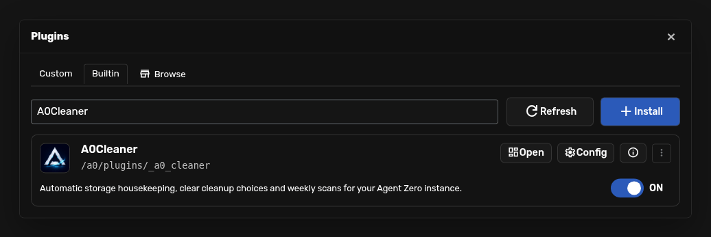
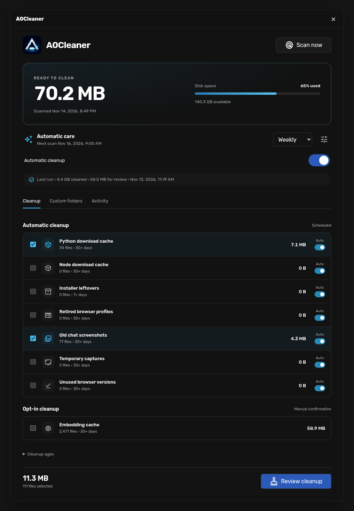
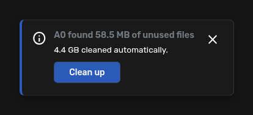
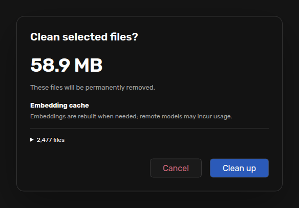
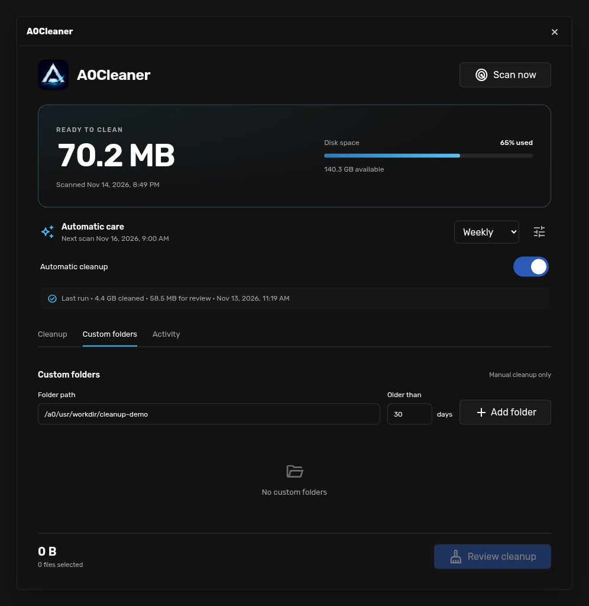

# Free up space with A0Cleaner

A0Cleaner clears the caches, old screenshots, and browser leftovers that build
up as you use Agent Zero. **Automatic cleanup is on by default**, with a weekly
run on Monday at 09:00 in the task's configured timezone. You can change what
it cleans, adjust the schedule, or review a cleanup yourself.

- [Open the cleaner](#open-the-cleaner)
- [Choose what runs automatically](#choose-what-runs-automatically)
- [Understand the notification](#understand-the-notification)
- [Change the schedule](#change-the-schedule)
- [Review and clean files yourself](#review-and-clean-files-yourself)
- [Add a custom folder](#add-a-custom-folder)
- [Check results](#check-results)

## Open the cleaner

Open **Plugins → Builtin**, search for **A0Cleaner**, and select **Open**.
You can also choose **Config → Open A0Cleaner**.

The cleaner scans when you first open it, or when its previous scan is more
than an hour old. Select **Scan now** whenever you want fresh numbers.
Scanning does not delete anything.

**Ready to clean** is the total found across the cleanup areas. The amount
beside **Review cleanup** is just your current selection. The disk meter
shows the storage available to your Agent Zero instance.

## Choose what runs automatically

The **Automatic cleanup** switch controls whether scheduled runs delete files.
Each area's **Auto** switch lets you keep that category out of future automatic
cleanups. These choices save as you change them.

These are the defaults:

| Area | Automatic | Files considered |
| --- | --- | --- |
| Python and Node download caches | On | Unchanged for 30 days. Packages can be downloaded again. |
| Installer leftovers | On | Temporary plugin and skill installation files older than 7 days. |
| Retired browser profiles | On | Profiles unchanged for 30 days. Shared and running profiles are kept. |
| Old chat screenshots | On | Screenshots older than 30 days in chats inactive for at least 30 days. Running and paused chats are kept. |
| Temporary captures | On | Browser and desktop captures older than 30 days. |
| Unused browser versions | On | Old Chromium installations unchanged for 30 days. Required and running versions are kept. |
| Embedding cache | Manual only | Cached embeddings older than 30 days. |
| Custom folders | Manual only | Files matching the age you choose for that folder. |

Clearing a retired browser profile removes its saved sign-ins and tabs.
Clearing screenshots removes those old previews. Turn off the corresponding
**Auto** switch if you want to keep them.

Expand **Cleanup ages** to change the cutoffs for **Download caches**,
**Installer leftovers**, or **Browser & chat files**. The last setting also
applies to the embedding cache. An age is an eligibility cutoff, not a promise
to delete every file: files in use or recently changed are skipped.

Built-in cleanup keeps chat text, uploaded files, installed models, and
applications. It cleans specific locations inside `/a0/tmp`; it does not sweep
Linux's separate `/tmp` directory or `/a0/usr/uploads`. Uploads can still be
needed by saved chats or queued messages. Time Travel manages its own retention.

## Understand the notification

After a scheduled run, Agent Zero tells you what happened. If files remain for
review, the toast says **A0 found … of unused files** and offers **Clean up**.
If it also cleaned files automatically, that amount appears underneath.

This example uses a saved maintenance result: 4.4 GB had already been cleaned,
and 58.5 MB remained for review. Your amounts will depend on your instance.

**Clean up opens the cleaner.** You still choose the areas and confirm before
a manual cleanup deletes anything.

The toast follows the schedule, so it normally appears once a week. It is not
triggered by **Scan now** or by opening the cleaner. Running the A0Cleaner task
manually from Tasks can also show it. A review toast stays until
you dismiss it with **×**; an unread one can reappear after refreshing the page.
When a run only cleans files and leaves nothing to review, the success toast
closes after about six seconds. If it finds and cleans nothing, there is no toast.

## Change the schedule

Under **Automatic care**, choose **Daily**, **Weekly**, **Monthly**, or **Off**.
The presets run at 09:00: weekly on Monday, monthly on the first day of the month.

Select the sliders button, **Schedule details**, to open the **A0Cleaner** task.
Use **Edit** to change its time or cron schedule. For a different timezone,
ask the agent to update the A0Cleaner task. You can also find it in
[Scheduled Tasks](task-scheduler.md).

- To keep scheduled scans and notifications but decide on every deletion,
  turn **Automatic cleanup** off and leave the schedule on.
- To stop scheduled scans as well, set the schedule to **Off**. You can still
  open the cleaner and scan manually.

If the container is off at the scheduled time, an enabled, idle task catches up
once after Agent Zero starts again. Several missed runs become one cleanup,
then the normal schedule resumes. Disabled tasks stay paused; failed or
interrupted runs need attention in Tasks.

## Review and clean files yourself

1. Select **Scan now** for an up-to-date list.
2. Use the checkboxes on the **left** to select only the areas you want to clean
   this time. Automatic areas with eligible files may already be selected.
   These boxes do not change the **Auto** switches on the right.
3. Select **Review cleanup**. Read the effect of each selected area and expand
   the file count to inspect the listed paths.
4. Select **Clean up** to permanently remove the selected files, or **Cancel**
   to leave them alone.

The embedding cache always needs your selection and confirmation. Embeddings
will be rebuilt when needed, which can use model credits if you use a remote
embedding provider.

## Add a custom folder

Use **Custom folders** for a scratch folder you deliberately want to clear.
Choose an existing subfolder inside A0's workdir, a project, downloads, uploads,
or `/a0/tmp`. Use the container path, such as `/a0/usr/workdir/cleanup-demo`,
rather than a path on your host computer.

1. Enter the **Folder path**.
2. Set **Older than** in days. For example, `30` keeps recently changed files.
   `0` includes all eligible files regardless of age.
3. Select **Add folder**. The cleaner scans it and adds a row with its size.
4. Select that folder's checkbox, check your total selection, and use
   **Review cleanup**.

Custom folders are **always manual**, even when automatic cleanup is on.
The **×** beside a folder removes its rule, not its contents. Project roots,
protected configuration, Git history, and managed cleanup locations cannot be
added as custom targets.

Choose folders whose contents you can discard. Adding an uploads subfolder
does not check whether a chat still references its files.

## Check results

**Last run** keeps the latest scheduled result visible, even after you run a
fresh scan. Open **Activity** for the cleanup history, including automatic or
manual runs, space cleaned, file counts, and skipped files.

| What you see | What to do |
| --- | --- |
| No files found | Check the ages and scan again after more use. A small result is normal after a recent cleanup. |
| An area is in use or could not be inspected | Let the related work finish, then scan again. The cleaner leaves unverified files alone. |
| Some files were skipped | Files may have changed or become active since the scan. Scan again before reviewing another cleanup. |
| A preview is no longer valid | Run **Scan now** and review the new selection. |
| Disk space changed less than the cleanup amount | Sizes are estimates. Docker's image layers and host storage can make reclaimed space differ from the reported file total. |

For the implementation reference, see the [A0Cleaner README](../../plugins/_a0_cleaner/README.md).
