# Use Codex with Your ChatGPT Account

Connect your ChatGPT account, choose Codex models, and carry on in Agent Zero.
You do not need to paste an OpenAI API key or install the Codex CLI for this
setup.

This guide starts with your first message in a fresh Agent Zero instance.
Account details and sign-in codes are hidden in the screenshots.

## Before you start

Use a ChatGPT account with access to Codex. The models you can select and your
usage limits depend on that account.

For a managed workspace, an administrator may need to allow device-code
sign-in first.

First, enable device code sign-in in ChatGPT:

1. Open your account menu and choose **Settings**.

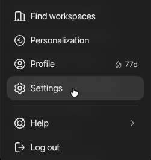

2. Select **Security and login** in the settings sidebar.
3. Scroll to the bottom and turn on **Enable device code sign-in for Codex,
   Excel, PowerPoint, and Word**.

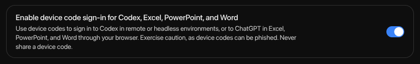

Then return to Agent Zero. OpenAI also documents this setting in its
[device-code sign-in instructions](https://developers.openai.com/codex/auth/#preferred-device-code-authentication-beta).

## 1. Open the Account setup

Open Agent Zero and send a message from the welcome screen. For example:
**Help me understand what Agent Zero can do for me.**

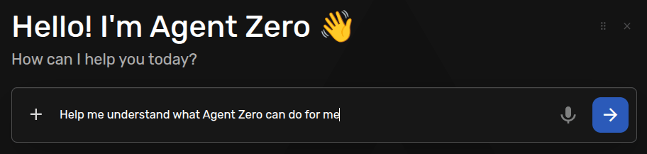

Agent Zero creates a chat and holds your message while you connect a model.
Click **AI account** in the chat. If onboarding is already open, select its
**Account** tab.

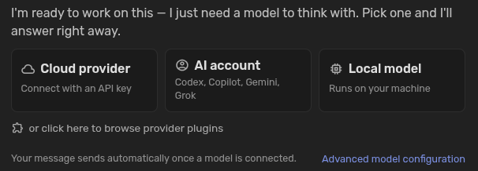

On the **Codex/ChatGPT** card, click **Connect account** to pick Codex.

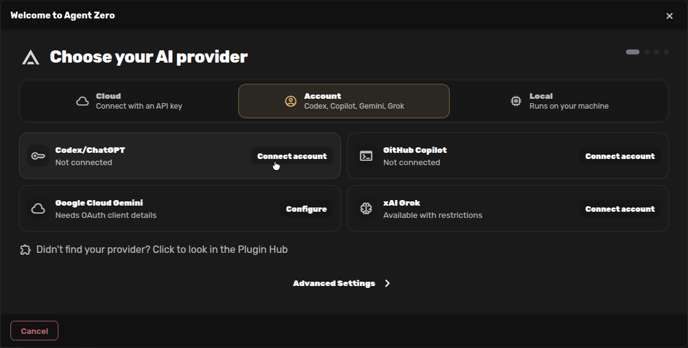

This opens **Choose your main model**. Click **Connect account** on this
screen to start sign-in.

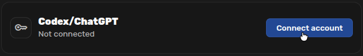

## 2. Copy your device code

Agent Zero opens an OpenAI sign-in page in another browser tab. Return to the
Agent Zero tab to copy the **Device code** shown under **Waiting for sign-in**.
You can select the code, right-click it, and choose **Copy**.

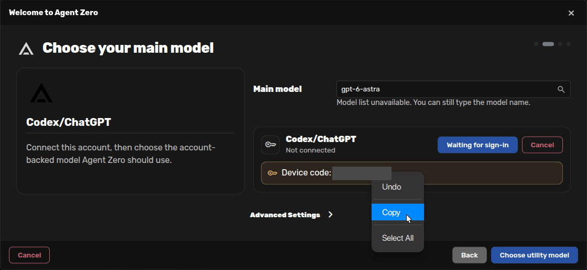

Keep the Agent Zero tab open while you finish signing in. Keep the code private
and use only the code from the connection you just started.

## 3. Authorize on OpenAI's page

Switch to the OpenAI tab and check that the address is on **auth.openai.com**.
Choose the ChatGPT account you want Agent Zero to use. If it is not listed,
click **Use another account** and sign in.

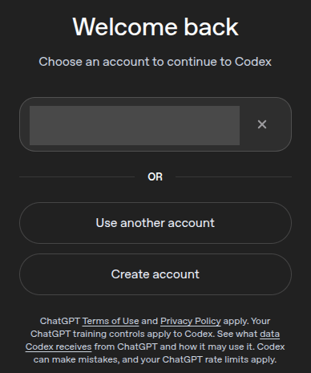

Paste the code from Agent Zero into the device-code fields, then click
**Continue**. OpenAI's page calls this access to **Codex CLI**; this is the
sign-in flow Agent Zero uses for the connection you started.

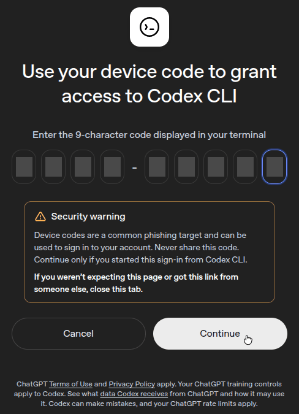

Wait for **Signed in to Codex**. You can then close that tab and return to
Agent Zero.

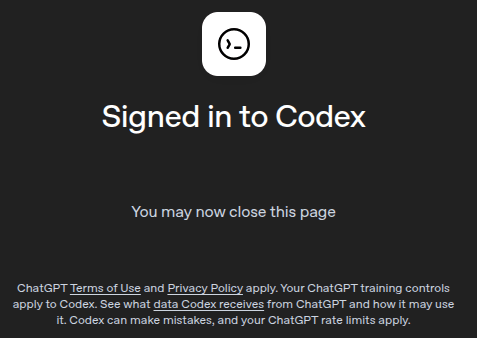

## 4. Choose the Main model

Back in Agent Zero, wait for the account to show a green checkmark. The model
list becomes available once the connection completes.

Click **Main model** or its search icon. Choose **gpt-6.1-terra** if it is
available in your account. You can type part of its name to narrow the list.
This is the model that handles your conversation and work.

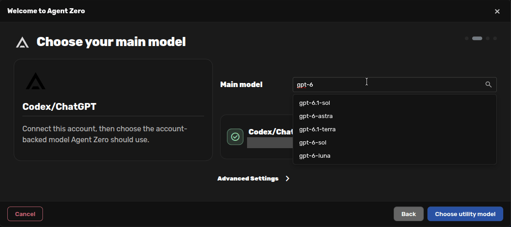

Click **Choose utility model** to continue.

## 5. Choose the Utility model

Keep **Utility provider** set to **Codex/ChatGPT Account** and select
**gpt-6-luna** if it is available. The Utility model handles shorter tasks such
as summaries and chat names.

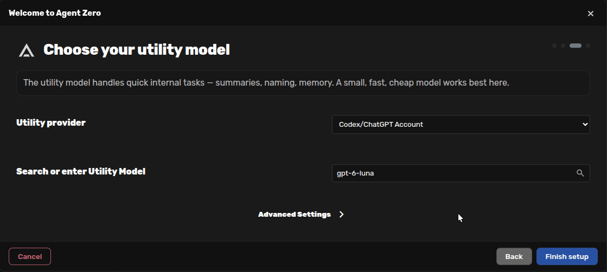

These are Agent Zero's onboarding suggestions when available. You can choose
different models from your account's list; the available names may change
over time. Check both choices, then click **Finish setup**. This saves your
choices and resumes the held message in its original chat.

## 6. Continue in your original chat

The **Agent Zero is ready** screen confirms setup. The extra connection cards
are optional. Click **Continue** to close onboarding.

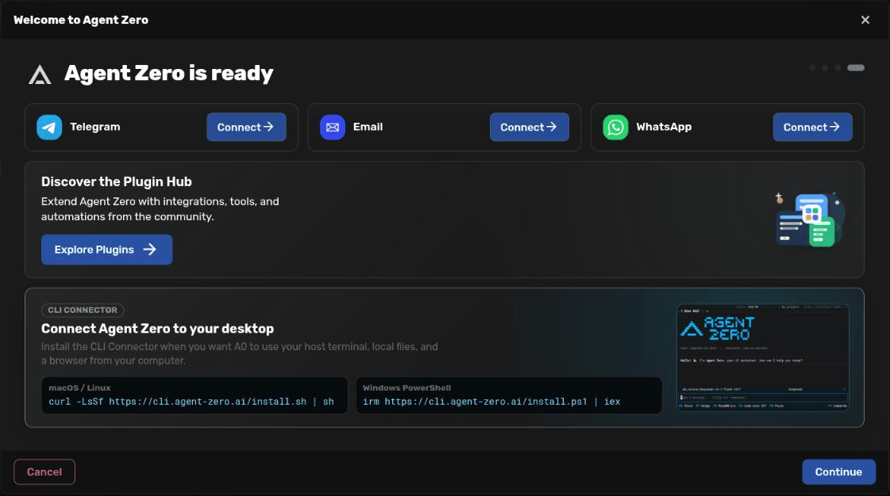

The reply to your first message appears in the same chat. There is no need to
send the message again or create another chat. You can carry on with a
follow-up question.

To change models later, open the preset menu above the composer and choose
**Edit Presets**. See [Model Presets](model-presets.md) for the details.

## If something gets stuck

- **The OpenAI tab did not open:** allow pop-ups for your Agent Zero address.
  Cancel the pending sign-in, then click **Connect account** again.
- **Device-code login is unavailable:** check the ChatGPT security setting or
  ask your workspace administrator to allow it.
- **The code expired or was rejected:** cancel the pending sign-in in Agent
  Zero and start a new connection. Copy the newly displayed code.
- **OpenAI says you are signed in, but Agent Zero is still waiting:** return
  to the Agent Zero tab and give it a moment to update. If it reports an
  error, start sign-in again.
- **The model list is empty:** finish signing in first. If the account is
  connected, open the model field again to retry loading the list. Choose
  a model your account can access.

For API keys, local models, and the other account providers, see
[First-Run Onboarding](onboarding.md).
