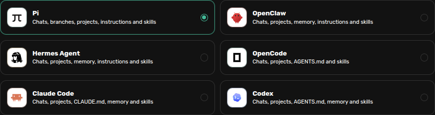
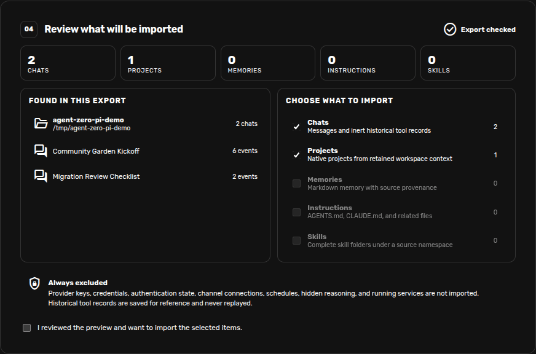

# Migrate chats into Agent Zero

Migrate Agents brings retained chats, projects, memories, instructions, and
skills from another agent into Agent Zero. You review the upload before
choosing what to import. The original files stay unchanged.

Supported sources are **Pi**, **Hermes Agent**, **Claude Code**, **Codex**,
**OpenCode**, and **OpenClaw**. Select the matching source to see its export
instructions. This walkthrough uses two real Pi demo chats.

## Open Migrate Agents

1. Open **Plugins** and select **Builtin**.
2. Find **Migrate Agents**, enable it if needed, and click **Open**.
3. Select the app you are importing from.



## Choose Pi sessions

Pi normally stores its session JSONL files under:

```text
~/.pi/agent/sessions/
```

Use **Choose files** for individual `.jsonl` sessions, or **Choose folder** for
a session folder. ZIP and TAR archives also work. If you configured a different
Pi agent or session directory, choose the files from there.

Use the original JSONL files. Pi's HTML export is a view of a conversation and
is not the migration input. You can add an `AGENTS.md` file and complete skill
folders separately if you want those imported too.

## Review and import

Click **Review selected data**. Check the chat titles, project paths, counts,
and any warnings. Uncheck categories you do not want, then check **I reviewed
the preview and want to import the selected items** and click **Import selected
data**.



The example contains **Community Garden Kickoff** and **Migration Review
Checklist**. Their shared workspace becomes one project when Projects is
selected. Import opens the first chat; the other chat is available in the
sidebar.

Open the imported chats and verify their messages and tool results before
continuing with a new request. The chats use Agent Zero's model configuration;
Pi provider credentials and settings are not transferred.

## What happens to branches and files?

- Each retained Pi branch becomes a separate chat. Shared earlier messages
  appear in each branch. A branch created only by metadata changes does not
  produce a duplicate chat.
- Tool calls and results are historical records. Import never executes them.
- A project created from a workspace path does not contain the original
  workspace files. Copy or upload needed files separately.
- Images become visible omission markers. Other file paths in messages remain
  references; they do not prove that an attachment was copied.
- Imported messages reflect retained original history. Pi's compacted context,
  context edits, summaries, and extension records are not reconstructed. A
  message hidden from Pi's current model context by an edit can still appear
  in its original form in the imported history.

For example, the kickoff chat retains the record of writing `garden-kickoff.md`.
To work on that document in Agent Zero, upload the actual file as well.

## Privacy and limits

Credentials, authentication files, provider configuration, system prompts,
hidden reasoning, and context-excluded shell commands are excluded. Obvious
secrets in retained text are redacted, but review imported material before
sharing it. Schedules and connected services are not transferred.

Uploads allow up to 5,000 files, 100 MiB per file, and 256 MiB expanded total.
Pi versions 1–3 are supported. A Pi session can contain up to 100 tree leaves
and 100,000 expanded entries. Repeated branch ancestors count toward another
256 MiB limit across the upload, including source content that is later omitted.
Broken or oversized sessions are skipped with a warning; fork smaller sessions
in Pi or upload fewer files when necessary.

For other source formats and detailed mappings, see the
[Migrate Agents reference](../../plugins/_migrate_agents/README.md).

## Related guides

- [Projects](projects.md)
- [Memory](memory.md)
- [Skills](skills.md)
- [Backup and restore](usage.md#backup-and-restore)
