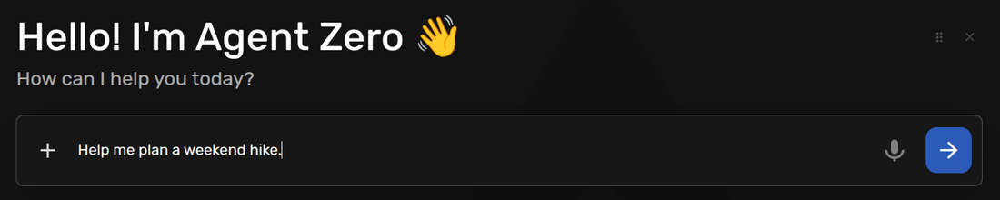
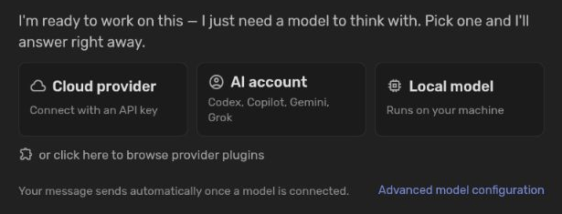
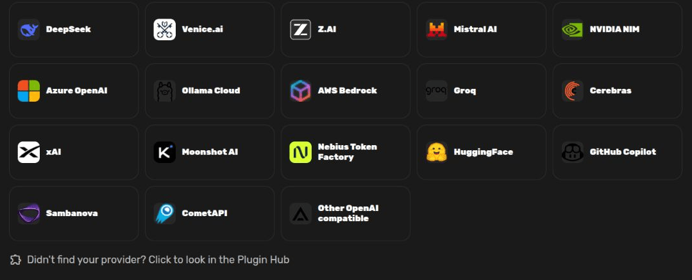
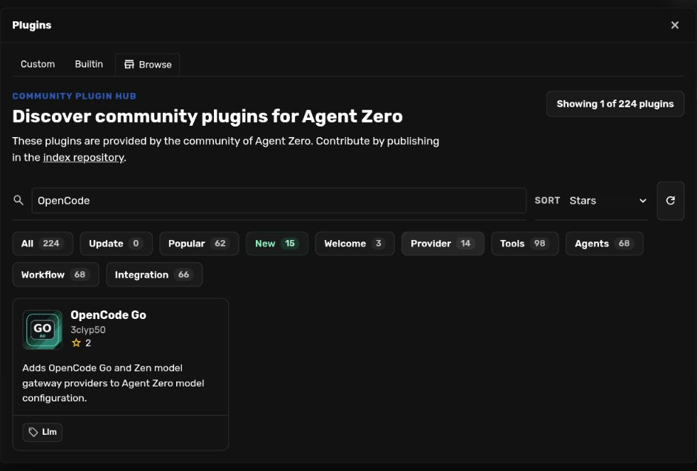
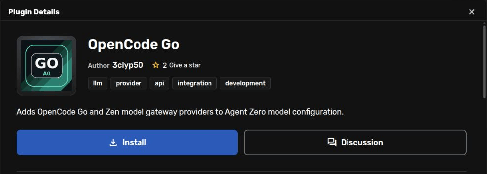
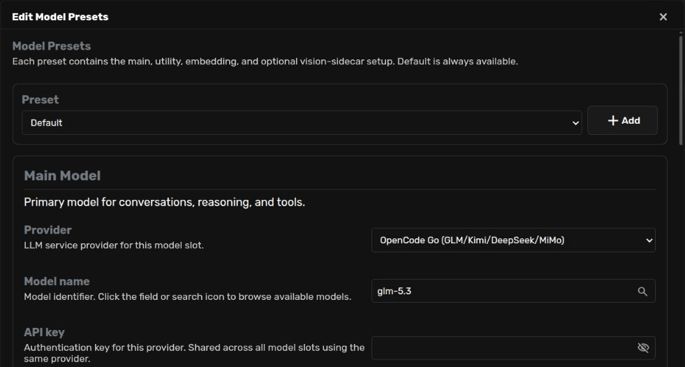
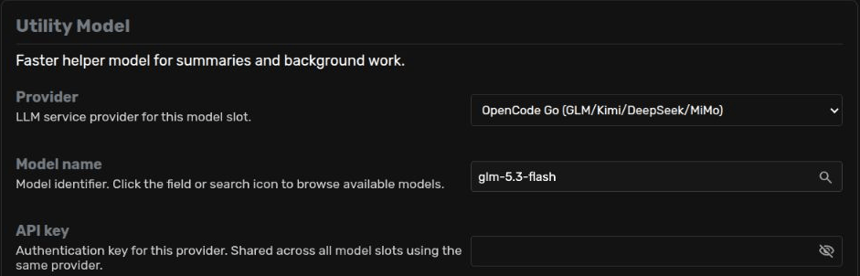

# Use OpenCode Go with Agent Zero

OpenCode Go is available through a community provider plugin. If you cannot
find it in the Cloud provider grid, open the Plugin Hub from that same screen,
install **OpenCode Go**, and choose its models in **Advanced model configuration**.

This guide starts with a fresh Agent Zero instance. The same route helps you
find other providers supplied as plugins.

## Before you start

You can install the plugin and explore the settings without a subscription.
To send messages through Go, you need your own OpenCode API key and an active
[OpenCode Go subscription](https://opencode.ai/docs/go/).
You do not need to install the OpenCode app to use this provider in Agent Zero.

The screenshots below stop at model configuration, with the key fields empty.
Installation and model selection were checked with OpenCode Go plugin 0.1.4;
model responses were not tested.

## 1. Send your first message

Open Agent Zero and type a message in the welcome screen's composer. For
example: **Help me plan a weekend hike.** Click the arrow to send it.

Agent Zero opens a chat and holds your message while you choose a model.
Click **Cloud provider**.

## 2. Find the provider-plugin link

OpenCode Go is not in the Cloud grid. Scroll to the bottom and click the puzzle
link: **Didn't find your provider? Click to look in the Plugin Hub**.

The **Account** and **Local** tabs have the same link. You can also go straight
to the Hub using **or click here to browse provider plugins** below the three
choices in the chat.

## 3. Install OpenCode Go

The Hub opens with **Provider** selected. Search for **OpenCode**, then open
**OpenCode Go** by **3clyp50**.

Read the description and README, and check the
[plugin's source](https://github.com/3clyp50/a0_opencode_go). It adds both Go and
Zen providers. This walkthrough uses Go.

Click **Install**. Read the third-party plugin warning. If you trust the plugin,
choose **Install Anyway**. Wait until the page shows **Installed**, then refresh
Agent Zero in your browser.

If the plugin already says **Installed**, skip installation and refresh the
page. You do not need to reinstall it.

## 4. Choose the Main model

Return to your chat. The held message and setup choices remain after the
refresh. Click **Advanced model configuration** at the bottom of the setup
message. This opens **Edit Model Presets**.

Leave **Preset** set to **Default** for this first setup. In **Main Model**:

1. Set **Provider** to **OpenCode Go (GLM/Kimi/DeepSeek/MiMo)**. Choose it by
   name; the other OpenCode entries serve different model groups or Zen.
2. Replace the old **Model name** with `glm-5.3`. You can type it or use the
   search icon and select it from the list. Changing the provider alone does
   not clear the previous model name.
3. When you are ready to connect, paste your OpenCode key into **API key**.

This example is for text chats. Turn **Supports Vision** off and leave the
separate vision settings empty for now. You can configure image analysis
later in [Model Presets](model-presets.md).

## 5. Choose the Utility model

Scroll to **Utility Model**. This model handles short background tasks such as
summaries and chat names. Choose the same Go provider, then replace the old
model name with `glm-5.3-flash`.

| Section | Model name |
| --- | --- |
| Main Model | `glm-5.3` |
| Utility Model | `glm-5.3-flash` |

These are the IDs shown by Agent Zero's model picker and
[OpenCode's Go model list](https://opencode.ai/docs/go/#endpoints). Enter them
exactly, without a `zai/`, `open/`, or `opencode-go/` prefix.

The free `glm-5.3-flash-free` model is a different offering. OpenCode's
[Console documentation](https://opencode.ai/docs/zen/#endpoints) says its free
chat models require the OpenCode client. Use the Go model above for this setup;
it is covered by your Go access, not a free Utility model.

Both sections share the API key when they use the same provider. Leave the
fresh instance's **Embedding Model** set to **HuggingFace** and
`sentence-transformers/all-MiniLM-L6-v2`.

## 6. Save when you are ready to connect

Check the provider, model names, and your key, then click **Save**. Return to
the chat. Once the model is configured, Agent Zero can retry your held message
automatically. Do not send it again while it is starting.

If you are only exploring and do not have Go access yet, click **Close** instead.
The plugin stays installed, but the unfinished preset changes are not saved.
Later, reopen **Advanced model configuration** from the chat. You can also
open the preset menu above the composer and choose **Edit Presets**.

## If something is missing

- **No OpenCode provider in the editor:** check that OpenCode Go is installed
  and enabled under **Plugins → Custom**, then refresh the browser page.
- **A model is missing from the search results:** check OpenCode's current
  model list and the plugin's updates. The Model name field also accepts an
  exact model ID typed by hand. Typing a name does not grant access to it.
- **A key or access error:** check the key and your Go subscription in the
  [OpenCode console](https://opencode.ai/console). Installing the plugin does
  not create an account or subscription.
- **Looking for another provider:** return to **Plugins → Browse**, select
  **Provider**, and search for its name. Follow that plugin's README for its
  provider choice, model names, and key requirements.

For the other setup routes, see [First-Run Onboarding](onboarding.md).
