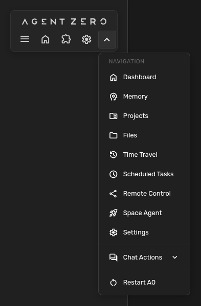
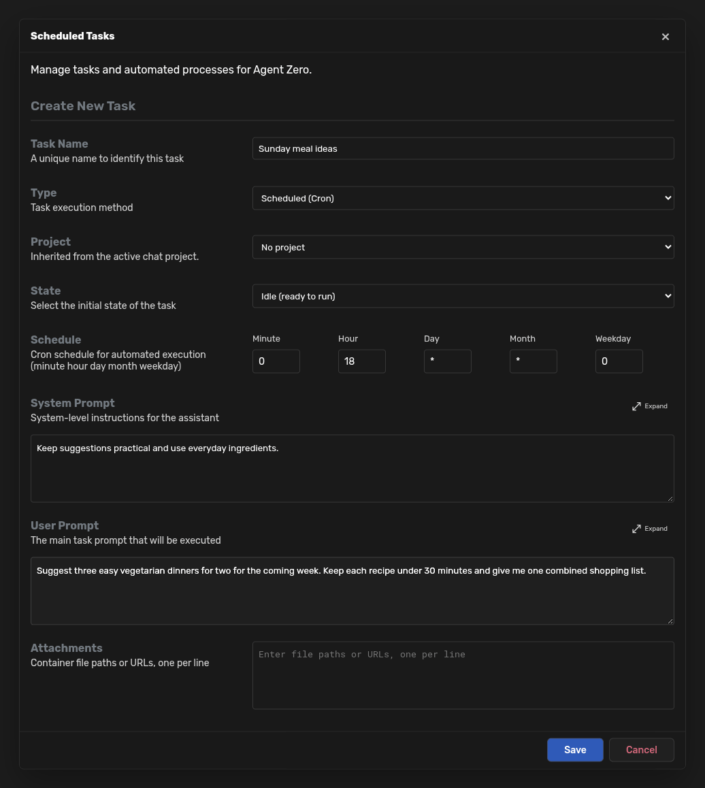
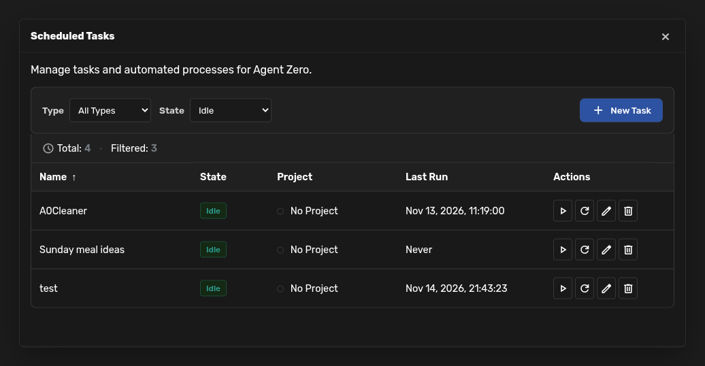
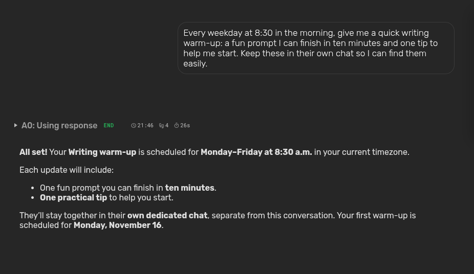
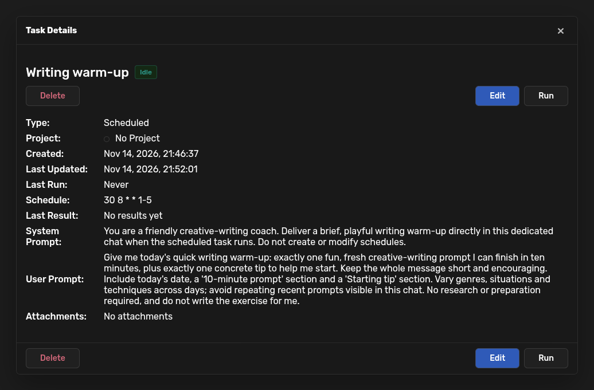
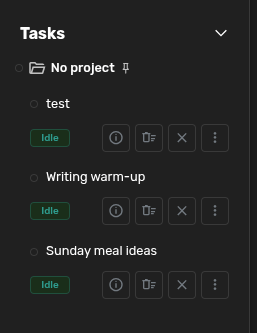

# Create a scheduled task

Ask Agent Zero to do something on a schedule, then come back to its results.
You can create a task in **Scheduled Tasks** or describe what you want in a
normal chat. Both methods save it in the same task list.

This guide uses two examples: Sunday dinner ideas created with the form, and
a weekday writing warm-up created through chat.

- [Open Scheduled Tasks](#open-scheduled-tasks)
- [Create a task with the form](#create-a-task-with-the-form)
- [Create a task through chat](#create-a-task-through-chat)
- [Find the task and its conversation](#find-the-task-and-its-conversation)
- [Run, pause, edit, or delete a task](#run-pause-edit-or-delete-a-task)
- [Check timing and missed runs](#check-timing-and-missed-runs)

## Open Scheduled Tasks

Open **More options**, the dropdown arrow at the top of the sidebar, then
select **Scheduled Tasks**. The modal lists saved tasks and their states.

Select **New Task** to open the creation form.

## Create a task with the form

Let's set up dinner ideas for Sunday at 18:00. Fill in these fields:

| Field | What to enter |
| --- | --- |
| **Task Name** | `Sunday meal ideas`, or another name you will recognize. |
| **Type** | **Scheduled (Cron)** for a repeating task. |
| **Project** | **No project** for this example. Choose a project if the task needs its files, instructions, or connections. The form initially uses the active chat's project. |
| **State** | **Idle (ready to run)**. Choose **Disabled** if you want to save it without enabling scheduled runs yet. |
| **Schedule** | Minute `0`, Hour `18`, Day `*`, Month `*`, Weekday `0`. |
| **System Prompt** | Optional guidance for how to respond. For example: “Keep suggestions practical and use everyday ingredients.” |
| **User Prompt** | The work to do each time. Use the dinner request below. |
| **Attachments** | Optional file paths inside Agent Zero or URLs, one per line. Leave empty for this example. |

For **User Prompt**, enter:

> Suggest three easy vegetarian dinners for two for the coming week. Keep each
> recipe under 30 minutes and give me one combined shopping list.

Put the timing in **Schedule** and the work in **User Prompt**. The task's
prompt should ask for the dinners, not ask Agent Zero to create another task.
Use **Expand** beside either prompt if you need more room to write.

### Read the five schedule fields

The fields run from left to right: **Minute, Hour, Day, Month, Weekday**.
`*` means every value in that field. Hours use the 24-hour clock, and weekday
`0` means Sunday; `1` through `6` mean Monday through Saturday.

| When | Minute | Hour | Day | Month | Weekday |
| --- | --- | --- | --- | --- | --- |
| Every day at 09:00 | `0` | `9` | `*` | `*` | `*` |
| Weekdays at 08:30 | `30` | `8` | `*` | `*` | `1-5` |
| Sundays at 18:00 | `0` | `18` | `*` | `*` | `0` |

**Five asterisks means every minute.** Replace the fields before saving.
New tasks use the timezone in **Settings → Agent → Locale**. With **Automatic
(browser)** selected, that comes from your browser.

For a one-time job, choose **Planned (Specific Times)**, pick the date and time,
and select **Add Time** before saving. You can add more than one date.
**Ad-hoc (Manual)** saves a task you run on demand, without a repeating schedule.

### Save and check it

Select **Save**. The form closes and **Sunday meal ideas** appears in the list.
**Idle** means ready for its next scheduled run; saving it does not run it
immediately.

Click its row to inspect the saved details. To try it now, select the triangle
button, **Run Task**, or **Run** inside Task Details. Open its conversation from
the sidebar **Tasks** section to watch the work and read the result.

## Create a task through chat

You can skip the form and ask in your own words. For example:

> Every weekday at 8:30 in the morning, give me a quick writing warm-up: a fun
> prompt I can finish in ten minutes and one tip to help me start. Keep these
> in their own chat so I can find them easily.

Send this in a normal chat. If you want the task to belong to a project, open
a chat in that project first. Mention a timezone if the time should be
different from your Agent Zero setting.

Wait for Agent Zero to confirm that it created the task. Then open
**More options → Scheduled Tasks** and find **Writing warm-up**. Click its row
to check the saved schedule and instructions. In this example, the schedule is
`30 8 * * 1-5`: weekdays at 08:30.

The wording of the confirmation can vary. The saved task is what tells you
the automation exists. If Agent Zero asks a follow-up question, answer it and
check the list once creation is confirmed.

## Find the task and its conversation

**Scheduled Tasks** is the complete list. Use its **Type** and **State** filters
to narrow it down. If a task seems missing, return to **All Types** and
**All States**.

Tasks with a **dedicated chat** also appear under **Tasks** in the sidebar.
Expand that section if it is collapsed, then select a task's name to open its
conversation. Both the form and the agent normally create dedicated chats;
each task's results stay together across runs.

If you ask Agent Zero to run a task in the current conversation instead, its
results stay in that shared chat under **Chats**. The task still appears in
**Scheduled Tasks**, but it does not get a separate sidebar task entry.

Plugin tasks such as [A0Cleaner](cleaner.md) can also appear in Scheduled Tasks.
They run the plugin's operation and do not need a task conversation.

## Run, pause, edit, or delete a task

Click a task's row for **Task Details**, including its schedule, **Last Run**,
**Last Result**, and saved prompts. For the ongoing conversation, select its
sidebar task entry.

| What you want | What to use |
| --- | --- |
| Run it now or run it again | **Run Task** (triangle) in the list, or **Run** in Task Details. A disabled task must be enabled first. |
| Pause the agent's current work | Open its conversation and select **Pause Agent**. Use **Resume Agent** to continue. |
| Stop future scheduled runs | **Edit Task** (pencil), choose **Disabled**, then **Save**. This does not cancel work already running. |
| Enable it again | Edit its state to **Idle** and save. |
| Change the prompt or schedule | **Edit Task**, update the fields, then **Save**. The task's type and project cannot be changed in this editor. |
| Make an interrupted task ready again | **Reset State** (circular arrow) returns it to **Idle**. It does not run the task or clear its conversation. |
| Delete it | **Delete Task** (trash), then click the confirmation checkmark. Deleting a dedicated task also removes its task chat. |
| Clear its conversation | **Clear task chat** in the sidebar. This erases the task's chat history while keeping its definition. It is not needed for an ordinary rerun. |

Scheduled runs currently do not show the regular **Stop agent** button.
Use **Pause Agent** when you need to interrupt the agent without deleting its
conversation. Resetting a state is not a way to stop work that is still running.

The state badges help you see what needs attention: **Idle** is ready,
**Running** is executing, **Disabled** is switched off, and **Error** needs a
look at the result or chat. Use **Run Task** to start work; selecting a state
label does not start an agent run.

## Check timing and missed runs

Agent Zero needs to be running to do the work. If a recurring task misses its
time while the container is off, an enabled, idle task catches up once after
startup. Several missed occurrences become one run, then the normal schedule
resumes. Disabled or failed tasks do not catch up automatically, and a run
interrupted by shutdown needs your attention.

Changing a recurring schedule or re-enabling a task starts its timing from
that change. Existing tasks keep their saved timezone; changing Locale does
not rewrite them. You can ask in chat, for example, “Change my writing warm-up
to 8:30 London time.”

Try the work once before relying on it unattended. A scheduled inbox summary
still needs a working email connection, and a task that uses an AI model uses
your normal model account and settings. Its results appear in Agent Zero;
delivery to email or another app needs to be part of the request and configured.
