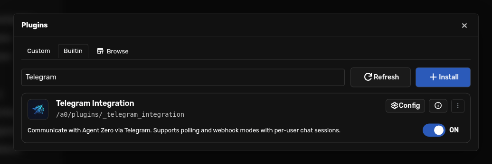
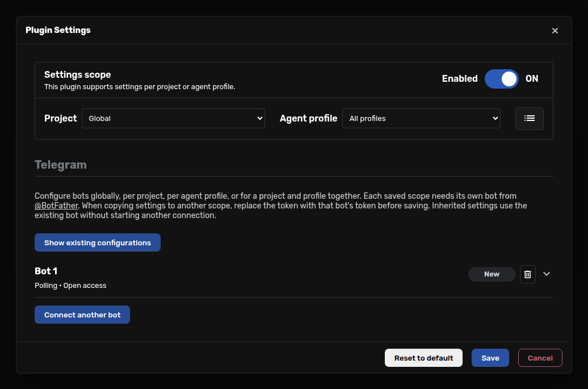
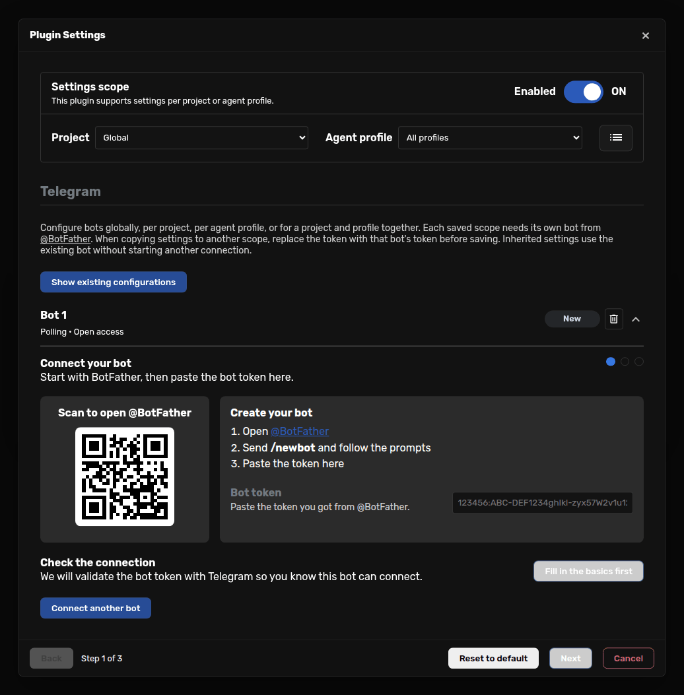
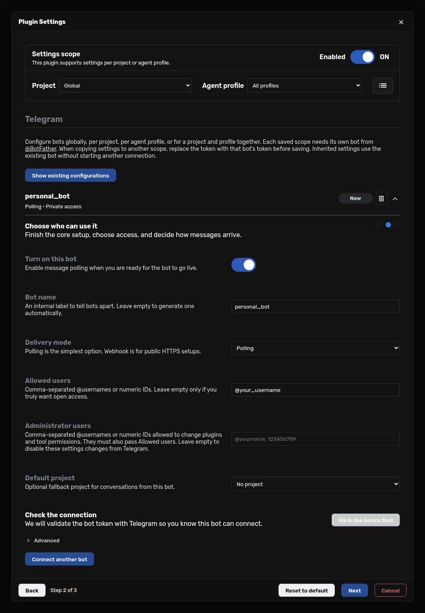

# Use Agent Zero from Telegram

Connect a Telegram bot, choose who can use it, and talk to Agent Zero from your
phone. Conversations also appear in the Web UI, so you can pick up the same work
at your desk.

Start with **one private bot using Polling**. You do not need a public website,
an incoming port, or a tunnel. Agent Zero must remain running and able to reach
Telegram; model usage follows your normal Agent Zero configuration.

This guide describes the scoped Telegram integration in **v2.15**. If you already
have a bot, start with [Upgrading an existing setup](#upgrading-an-existing-setup).
The screenshots use an unsaved example configuration, with no real credentials.

- [Connect your first bot](#connect-your-first-bot)
- [Choose who can use it](#choose-who-can-use-it)
- [Use commands and attachments](#use-commands-and-attachments)
- [Use projects and agent profiles](#use-projects-and-agent-profiles)
- [Add a bot to a group](#add-a-bot-to-a-group)
- [Use a webhook](#use-a-webhook)
- [Upgrading an existing setup](#upgrading-an-existing-setup)
- [Troubleshooting](#troubleshooting)

## Connect your first bot

### 1. Check Agent Zero first

Send a short message in the Web UI and make sure Agent Zero replies. If model
setup is incomplete, finish [Onboarding](onboarding.md) before connecting
Telegram. A working bot token does not configure an AI model.

### 2. Create a bot with BotFather

Open the official [@BotFather](https://t.me/BotFather) in Telegram, send
`/newbot`, and follow its prompts for a display name and a unique bot username.
BotFather gives you a **bot token**. Keep it private: it controls the bot.
You do not need to write code or install another Telegram plugin.

Your bot's `@username`, your own `@username`, and the token are different things.
The token goes in Agent Zero; your own account goes in **Allowed users**.
See Telegram's [bot creation guide](https://core.telegram.org/bots/features#creating-a-new-bot)
for the BotFather steps.

### 3. Open Telegram settings

In Agent Zero, open **Plugins → Builtin**, search for **Telegram**, and click
**Config** on **Telegram Integration**. The welcome screen's **Connect Channels →
Telegram** shortcut opens the same settings when that card is visible.



For your first bot, leave **Project: Global** and **Agent profile: All profiles**
at the top. Make sure the plugin's **Enabled** toggle is on. If a bot is already
listed, use **Connect another bot** to add a different bot, or open the existing
card to edit it.



In **Connect your bot**, paste the token into **Bot token**, then click **Next**.
The QR code opens BotFather; it does not sign in to your personal Telegram
account.



### 4. Make it private before saving

In **Choose who can use it**, use these settings:

| Setting | First-bot choice |
| --- | --- |
| Bot name | A short internal label, such as `personal_bot`. This does not rename the Telegram account. |
| Delivery mode | **Polling**. |
| Allowed users | Your own exact `@username` from Telegram Settings, or your numeric Telegram user ID. |
| Administrator users | Leave empty to manage settings only from the Web UI. |
| Default project | **No project**, or an existing project where new conversations should start. |
| Turn on this bot | Enable it once the access list is filled in. |

Replace `@your_username` in the example below with your own account. Do not use
the bot's username, a phone number, or a group chat ID.



Click **Next**. In **Shape the conversation**, choose **Ignore group messages**
for a private-message-only bot. Optional **Agent instructions** can ask for
shorter, mobile-friendly replies. Click **Save** when you finish the wizard.

**Allowed users must not be empty for a private bot.** An empty list lets anyone
who finds the bot reach your Agent Zero and use the capabilities available to
its agent. A hard-to-guess bot username is not an access control.

### 5. Verify the full conversation

Use **Check the connection** in the bot card to validate the token. A successful
check means Telegram accepted the credentials; it does **not** prove that
delivery, permissions, or the AI model are working. The **Live** label reflects
the configuration, not a completed message exchange.

After saving, allow a short time for the bot to start. In Telegram:

1. Open **your new bot**, not BotFather, and tap **Start** or send `/start`.
2. Send `/status` to check the chat's project, agent profile, and model.
3. Send `Reply with: Telegram is ready.` and wait for the agent's response.
4. Find the Telegram conversation in Agent Zero's Web UI.

If `/status` works but the normal message fails, check the model configuration
and the conversation's error in the Web UI. If neither arrives, use the
[troubleshooting table](#troubleshooting).

## Choose who can use it

**Allowed users** is a comma-separated list, for example
`@your_username, @teammate_username`. Use numeric Telegram **user IDs** when you
know them: they keep the rule tied to the account when a username changes.
If using usernames, copy their spelling exactly and review the list after
account changes. Do not clear the list just to troubleshoot an access problem.

**Administrator users** is a separate list. Administrators must also pass
**Allowed users**. Leave it empty unless you want trusted users to change
settings from Telegram:

- `/permissions` changes the current profile's tool permissions in its scope.
- `/plugins` can change plugin activation for the **whole instance**.
- Administrators can attach an otherwise unbound Web UI chat using `/sessions`,
  if its project/profile is accessible to the bot.

This list is unrelated to Telegram group administrators or ownership in
BotFather. Those roles do not automatically grant Agent Zero administration.

Each sender has a separate conversation binding for that bot and Telegram chat.
Another Telegram user's bound sessions are not available in the session picker.
Group replies are still visible to members of the group. Separate conversations
and scoped routing are not a sandbox for files or tools: give trusted people
access and choose suitable [agent permissions](agent-profiles.md).

## Use commands and attachments

Send `/commands` to see the commands available to the current chat. Custom and
project commands can change that list. Common built-in actions include:

| Command | What it does |
| --- | --- |
| `/status` | Show the current project, agent, model, and queue state. |
| `/new` | Start a new conversation; keep the previous one. |
| `/sessions` | Choose an accessible conversation bound to this bot, user, and chat. |
| `/project`, `/agent`, `/model` | Open a picker; choices must respect the bot's scope and permissions. |
| `/stop` | Stop the current work. |
| `/compact` | Ask for confirmation before summarizing a long conversation. |
| `/copy` | Send the conversation transcript as a text file. |
| `/clear` | Reset the current conversation; use `/new` when you want to retain it. |

Use Telegram's attachment button for photos, documents, audio, voice messages,
or video. Add a caption explaining what you want. Agent Zero can send files back;
what it can understand or produce depends on your models and enabled tools.

Under **Advanced**, **Attachment max age** controls cleanup of downloaded
attachments in **hours**. `0` keeps them indefinitely. This setting does not
delete the Telegram message or act as a complete chat-retention policy.

## Use projects and agent profiles

A **project** supplies the workspace and project instructions. An **agent
profile** supplies the agent's role and configuration. The **Settings scope**
selectors determine who owns the Telegram configuration:

| Project selector | Agent profile selector | Bot ownership |
| --- | --- | --- |
| Global | All profiles | General-purpose bot; can use destinations that inherit its configuration and permit Telegram. |
| A project | All profiles | Bot stays in that project; it can use permitted profiles there. |
| Global | A profile | Bot stays on that profile; it can use permitted projects. |
| A project | A profile | Bot stays in that project and on that profile. |

Create the project/profile first, then select it at the top of Telegram settings.
The chosen profile must be available in the chosen project. See
[Projects](projects.md) and [Agent Profiles](agent-profiles.md).

### One saved configuration, one set of bot accounts

**Each explicitly saved scope needs different Telegram bot accounts.** For
example, use one bot for personal work and another for a support project. One
scope can contain several bots, but none of their tokens can also belong to
another saved scope or another running Agent Zero instance.

To reuse a setup in a new scope:

1. Create another bot with BotFather's `/newbot`.
2. Select the destination project/profile in Telegram settings.
3. Copy the settings you need, but replace every inherited/copied token with
   the token for the new bot before saving. Remove bot entries you do not need.
4. Review Allowed users and Administrator users for this destination.
5. Save, open the new bot in Telegram, and verify `/status` and a normal reply.

Copying a token does not clone a bot. Rotating a token also keeps the same bot
identity, so it does not solve a duplicate-scope conflict.

### Inheritance does not need another bot

If a scope has no saved Telegram configuration, it can inherit an existing one
without starting another connection. A saved scoped configuration replaces the
**whole bot list** for that scope; lists are not merged. Use **Show existing
configurations** to see where overrides exist.

The **Enabled** toggle also has scopes. Disabling Telegram for a project/profile
blocks delivery there even when the bot is inherited. An explicitly enabled
scoped bot can run while the global plugin is disabled. Use **Review saved
activation overrides** when that button is shown.

For a global bot, **Default project** and **Advanced → User project mapping**
choose where new conversations start. A mapping looks like
`123456789=support_project`, using the Telegram user ID and the actual project
name. These are starting destinations, **not project access restrictions**.
Use a project-owned bot when it must remain in one project. Changing a default
or mapping does not move an already-bound conversation; use an allowed picker
choice or `/new`.

To **move** a bot instead of creating another, remove its token from the old
configuration and save before adding it to the new scope. Old chats remain,
but the destination scope starts its own session bindings. Keep an existing
**Bot name** unchanged when you want to preserve its current bindings.

## Add a bot to a group

First verify a private conversation. Add the bot to the group, keep Allowed users
limited to the people who should use it, and choose **Group behavior**:

| Choice | Behavior |
| --- | --- |
| Reply when @mentioned or replied to | Agent Zero handles mentions and replies to the bot among messages Telegram delivers. |
| Reply to every group message | Agent Zero handles every delivered message from allowed users. |
| Ignore group messages | Private conversations only. |

Telegram has its own **Privacy Mode**, separate from this setting. With privacy
enabled, start with `/start@YourBotUsername` and then **reply to a bot message**.
A plain `@mention` is not a reliable delivery test. If you intentionally need
every group message, change the bot's privacy setting in BotFather and re-add
it to the group so the change takes effect. Do not grant group administration
just to make replies work. See Telegram's
[Privacy Mode explanation](https://core.telegram.org/bots/features#privacy-mode).

**Welcome new members** and **Welcome message** are optional; `{name}` inserts
the new member's name. Group membership and group-admin status never replace
the Agent Zero access lists.

## Use a webhook

Stay with Polling unless you already operate a public HTTPS endpoint. Both modes
support the same Agent Zero conversations; webhooks change how updates arrive.

1. Set **Delivery mode → Webhook**.
2. Set **Webhook URL** to the public Agent Zero **base URL**, such as
   `https://agent.example.com`. Agent Zero appends the webhook route; do not
   paste a bot token or manually constructed Telegram API URL here.
3. Under **Advanced**, set **Webhook secret** to a random value of 32–256 letters,
   digits, underscores, or hyphens. This is separate from the bot token. One
   way to generate a suitable value locally is:

   ```bash
   python3 -c 'import secrets; print(secrets.token_urlsafe(32))'
   ```

4. Save. Ensure Telegram can reach the endpoint through a valid HTTPS setup and
   that your reverse proxy forwards the `X-Telegram-Bot-Api-Secret-Token` header.
   Keep Web UI authentication in place; a webhook is not a reason to expose the
   rest of Agent Zero without protection.
5. Repeat `/status` and the normal-message test. The connection-check button
   validates the token, not public webhook reachability.

Agent Zero rejects missing or incorrect webhook secrets, and rejects webhook
delivery to polling bots. Returning to Polling removes its webhook. Do not run
another polling process or service with the same bot token. Telegram's
[webhook FAQ](https://core.telegram.org/bots/faq#im-having-problems-with-webhooks)
covers its HTTPS requirements.

## Upgrading an existing setup

You do not need to recreate working bot settings. Before the first bot lifecycle
pass after this upgrade, Agent Zero automatically backs up existing Telegram
configurations, activation overrides, and session mappings under:

```text
usr/plugins/_telegram_integration/backups/config-scopes-v1/
```

Existing values and mappings are retained. The one automatic settings change is
to generate a valid secret for a legacy webhook configuration whose secret is
missing or invalid. Valid secrets are kept. No administrator is added, and
access lists are not widened or merged. A pre-existing empty Allowed users list
stays open, so review it after upgrading.

The backup contains credentials: keep it private and include your persistent
`usr/` data in normal [backups](usage.md#backup-and-restore). It is a migration
snapshot, not a replacement for a complete backup. No manual migration command
is needed.

**Scoped settings alone no longer pause every bot.** If old configurations reuse
the same bot, all conflicting connections pause until you resolve the duplicate:

1. Open **Show existing configurations** and inspect each saved scope.
2. Decide which scope should keep the original bot.
3. Remove that bot entry/token from other scopes, or replace it with a newly
   created bot. Save each change. Merely turning a duplicate bot off does not
   remove its saved ownership.
4. Review activation overrides and test again after the manager reloads.

No conflicting files are automatically deleted and no scope is silently chosen
over another. Keep bot names stable; deliberately renaming a bot or moving it
to another scope starts new session bindings while retaining the previous chats.

## Troubleshooting

| What you see | What to check |
| --- | --- |
| Telegram is missing from the list | Choose **Builtin**, not Browse or Custom. Search for **Telegram Integration**. |
| Token check fails | Copy the token from the correct BotFather bot, remove accidental whitespace, and check outgoing network access. If exposed, revoke it in BotFather and update the owning configuration. |
| Token check passes, but no replies | Save the settings; check both Enabled and Turn on this bot, Allowed users, destination scope, and activation overrides. Open the bot and send `/start`. Check Web UI notifications/logs for startup errors. |
| `/status` works, but normal messages fail | Open the same chat in the Web UI and check its model, credentials, provider availability, and tool errors. |
| Works privately, silent in a group | Check Group behavior, the sender's access entry, and Telegram Privacy Mode. Test with a command addressed to the bot and a reply to its message. |
| Save reports a reused bot, or bots pause after upgrade | Review every saved configuration. Remove or replace duplicate bot accounts, including old/rotated tokens. Check that another instance is not running the same bot. |
| `/project` or `/agent` refuses a choice | The bot must stay within its owning scope; the destination must permit Telegram, inherit the right bot, and make the profile available. |
| `/sessions` does not show a chat | Only accessible sessions belonging to this bot, user, and Telegram chat are listed. An explicit administrator may also attach an unbound Web UI chat. |
| `/plugins` or `/permissions` is unavailable | The sender must pass Allowed users and be listed in Administrator users. An empty administrator list intentionally disables those settings changes. |
| Webhook bot is silent | Check the public base URL, HTTPS, reverse-proxy routing, and secret header. Use a real message to test delivery. |
| Saved settings cannot be read | Review the affected configuration in the Web UI or restore it from your backup. Delivery pauses rather than falling back to more permissive settings. |

For implementation details, see the [plugin reference](../../plugins/_telegram_integration/README.md)
and [Agent Zero on DeepWiki](https://deepwiki.com/agent0ai/agent-zero).
