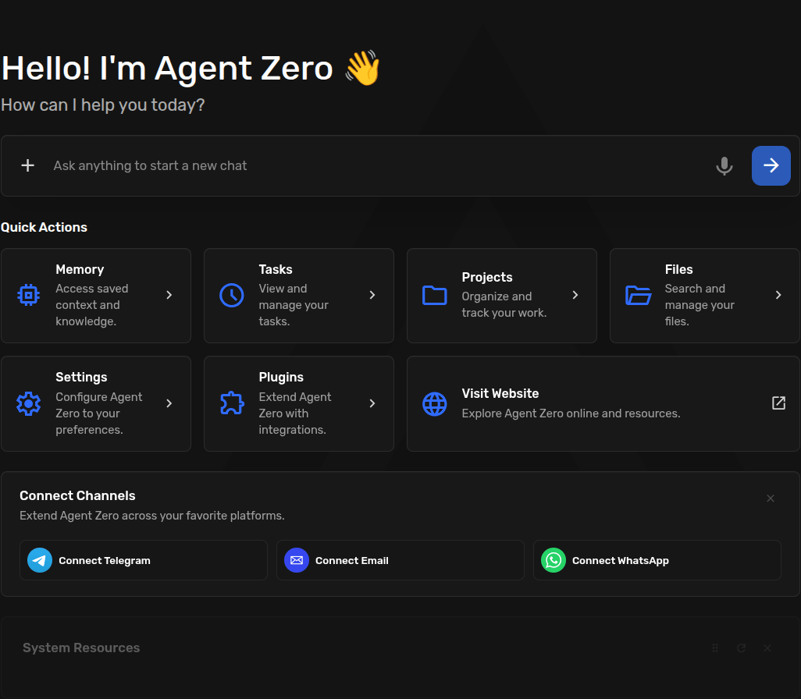
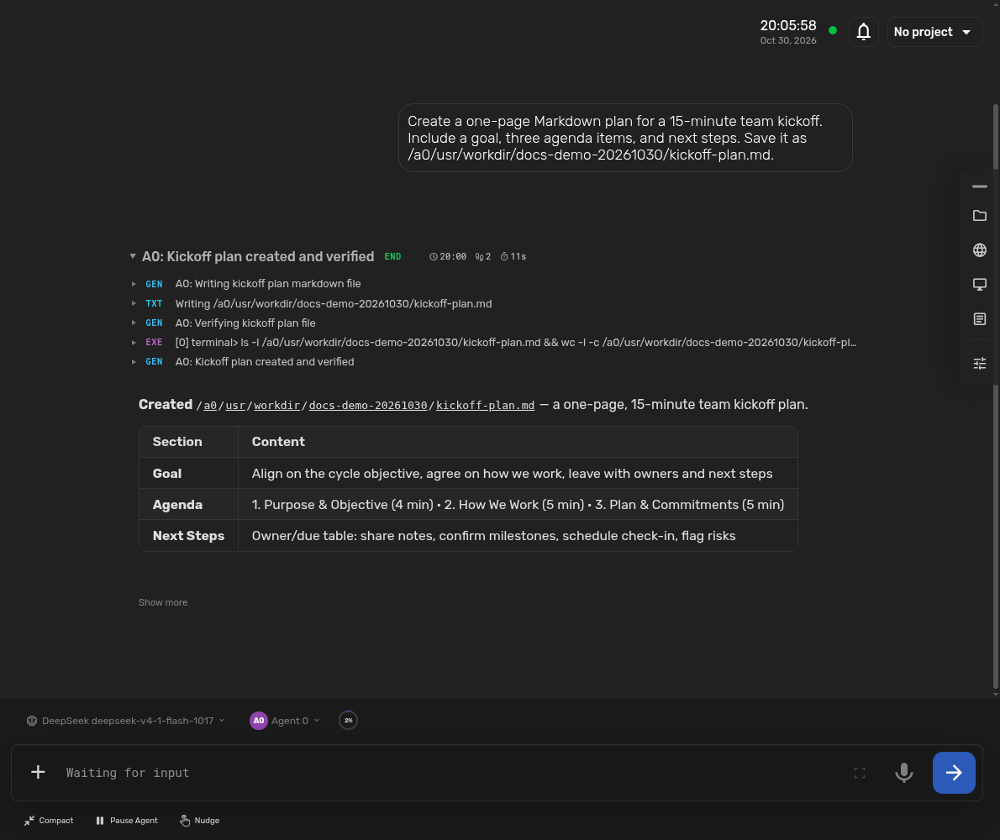

# Quick Start

Start Agent Zero, open the Web UI, and give it a small, concrete job. If models
need setup, Agent Zero keeps your first message while you configure them.

## Install and open Agent Zero

Use [A0 Launcher](guides/launcher.md) for guided desktop setup. It can prepare
the local runtime, install Agent Zero, and open local or remote Instances.

For a terminal installation, use A0 Install:

**macOS / Linux:**
```bash
curl -fsSL https://bash.agent-zero.ai | bash
```

**Windows (PowerShell):**
```powershell
irm https://ps.agent-zero.ai | iex
```

Follow the installer prompts for port and authentication. Open the Web UI URL
shown by Launcher or the terminal. See the [Installation Guide](setup/installation.md)
for downloads, direct Docker, shared folders, and updates.

## Send your first message

The welcome screen has a message box. Type a request there and press Enter;
Agent Zero creates the chat for you. **New Chat** in the sidebar also starts a
fresh conversation.



Try a small task with an obvious result:

```text
Create a one-page Markdown plan for a 15-minute team kickoff.
Include a goal, three agenda items, and next steps.
Save it as /a0/usr/workdir/docs-demo-20261030/kickoff-plan.md.
```

If models are not configured, the chat offers **Cloud provider**, **AI account**,
or **Local model**. Choose a path, set the main and utility models, and finish
setup. Agent Zero retries the message it was holding; you do not need to send
it again. See [First-Run Onboarding](guides/onboarding.md) for the walkthrough.

> [!TIP]
> If the welcome message box is hidden, use **Show all dismissed** at the bottom
> of Welcome. See [Customize Welcome](guides/usage.md#customize-welcome).

## Follow the work and open the result

Watch the response and expand tool rows when you want to see what Agent Zero
did. The example below writes a Markdown plan and returns a link to the file.



Use **Pause Agent** and **Resume Agent** to pause and continue a conversation.
Messages sent during a run enter its queue; use **Send now** on a queued item
when you want to send that correction immediately. The
[Usage Guide](guides/usage.md#while-agent-zero-is-working) explains the queue,
Stop, Nudge, and other controls.

## Optional: work on files on your computer

Agent Zero normally works inside its container. To give it access to host
files, use Launcher **Host access**, the
[A0 CLI Connector](guides/a0-cli-connector.md), or an explicitly shared
[local folder](guides/local-folders.md).

For A0 CLI, run the installer on your host computer:

**macOS / Linux:**
```bash
curl -LsSf https://cli.agent-zero.ai/install.sh | sh
```

**Windows (PowerShell):**
```powershell
irm https://cli.agent-zero.ai/install.ps1 | iex
```

Then run `a0` and connect to your running Agent Zero instance. The
[connector guide](guides/a0-cli-connector.md) covers host selection and access
controls.

## Next Steps
Now that you've run a simple task, you can experiment with more complex requests. Try asking Agent Zero to:

- Create a project for a focused workspace.
- Use the built-in Browser to research, screenshot, or annotate a page.
- Open the Desktop when you want Linux GUI apps or LibreOffice Cowork.
- Review Memory when Agent Zero seems to keep the wrong assumption.
- Connect A0 CLI when Agent Zero should work on host-machine files.
- Use **+ → Skills** when you want to pin or remove a skill in the current chat.
- Choose an Agent Profile for a repeatable role, instructions, model preset, and capability permissions.
- Use the first model dropdown when you want to choose or edit Model Presets.
- Attach files and ask for a summary, edit, or conversion.
- Create a scheduled task for recurring work.
- Explore plugins when you need installed integrations or custom UI features.

### [Open A0 Browser Guide](guides/browser.md)

Explains the built-in Browser, live Browser Canvas, screenshots, annotations, host-browser mode through A0 CLI, and Chrome extensions.

### [Open A0 Desktop Guide](guides/desktop.md)

Shows the right-side Canvas Linux desktop, the New menu for Markdown/Writer/Spreadsheet/Presentation files, and LibreOffice Cowork.

### [Open A0 Memory Guide](guides/memory.md)

Explains how to search, edit, delete, export, and curate memories before stale context starts steering the agent.

### [Open A0 Skills Guide](guides/skills.md)

Shows the chat input **+** menu, the Skills selector, and how active skills are added to prompt protocol.

### [Open A0 Agent Profiles Guide](guides/agent-profiles.md)

Shows how to switch profiles, create one in Easy mode, edit prompts in Advanced
mode, and set Tool, MCP, Skill, and project-availability policies.

### [Open A0 Model Presets Guide](guides/model-presets.md)

Explains presets as simple named shortcuts for model setups.

### [Open A0 Usage Guide](guides/usage.md)

Provides more in-depth information on chat controls, tools, projects, tasks, and backup/restore.

## Video Tutorials
- [MCP Server Setup](https://youtu.be/pM5f4Vz3_IQ)
- [Projects & Workspaces](https://youtu.be/RrTDp_v9V1c)
- [Memory Management](https://youtu.be/sizjAq2-d9s)
