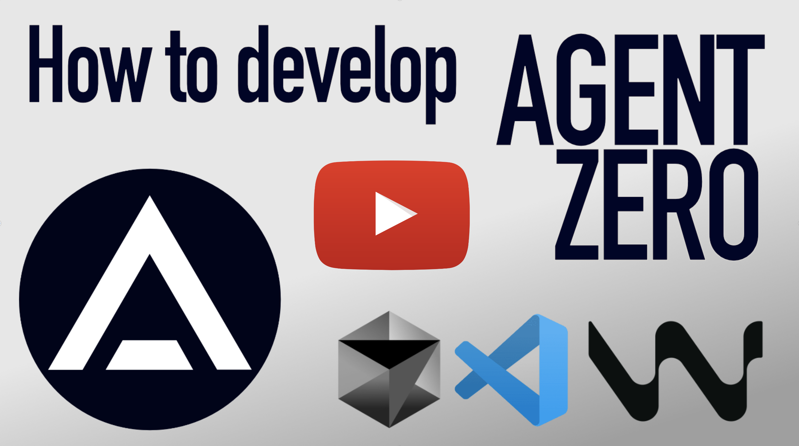

# Development manual for Agent Zero
This guide will show you how to setup a local development environment for Agent Zero in a VS Code compatible IDE, including proper debugger.


[](https://www.youtube.com/watch?v=KE39P4qBjDk)


> [!WARNING]
> This guide is for developers and contributors. It assumes you have a basic understanding of how to use Git/GitHub, Docker, IDEs and Python.

> [!NOTE]
> - Agent Zero runs in a Docker container, this simplifies installation and ensures unified environment and behavior across systems.
> - The Python framework can also run on your machine in an IDE. File operations and scheduler jobs run in that local process. Code execution uses the selected local, SSH, connected-host or sandbox destination; it does not require a sibling Agent Zero instance for development RFC calls.


## To follow this guide you will need:
1. VS Code compatible IDE (VS Code, Cursor, Windsurf...)
2. Python environment (Conda, venv, uv...)
3. Docker (Docker Desktop, docker-ce...)
4. (optional) Git/GitHub

> [!NOTE]
> I will be using clean VS Code, Conda and Docker Desktop in this example on MacOS.


## Step 0: Install required software
- See the list above and install the software required if you don't already have it.
- You can choose your own variants, but Python, Docker and a VS Code compatible IDE are required.
- For Python you can choose your environment manager - base Python venv, Conda, uv...

## Step 1: Clone or download the repository
- Agent Zero is available on GitHub [github.com/agent0ai/agent-zero](https://github.com/agent0ai/agent-zero).
- You can download the files using a browser and extract or run `git clone https://github.com/agent0ai/agent-zero` in your desired directory.

> [!NOTE]
> In my case, I used `cd ~/Desktop` and `git clone https://github.com/agent0ai/agent-zero`, so my project folder is `~/Desktop/agent-zero`.

## Step 2: Open project folder in your IDE
- I will be using plain and clean VS Code for this example to make sure I don't skip any setup part, you can use any of it's variants like Cursor, Windsurf etc.
- Agent Zero comes with `.vscode` folder that contains basic setup, recommended extensions, and debugger profiles. These will help us a lot.

1. Open your IDE and open the project folder using `File > Open Folder` and select your folder, in my case `~/Desktop/agent-zero`.
2. You will probably be prompted to trust the directory, confirm that.
3. You should now have the project open in your IDE


# Step 3: Prepare your IDE:
1. Notice the prompt in lower right corner of the screenshot above to install recommended extensions, this comes from the `.vscode/extensions.json` file. It contains Python language support, debugger and error helper, install them by confirming the popup or manually in Extensions tab of your IDE. These are the extensions mentioned:
```
usernamehw.errorlens
ms-python.debugpy
ms-python.python
```

Now when you select one of the python files in the project, you should see proper Python syntax highlighting and error detection. It should immediately show some errors, because we did not yet install dependencies.


2. Prepare the python environment to run Agent Zero in. This step assumes you have some Python runtime installed. By clicking the python version in lower right corner (3.13.1 in my example), you should get a list of available environments. You can click the `+ Create Virtual Environment` button. You might be prompted to select the environment manager if you have multiple installed. I have venv and Conda, I will select Conda here. I'm also prompted for desired python version, I will select 3.12, that is known to work well.


- Your new environment should be automatically activated. If not, select it in the lower right corner. You might need to open a new terminal in VS Code to reflect the changes with `Terminal > New Terminal` or clicking the `+` button in the terminal tab. Your terminal prompt should now start with your environment name/path, for example `(/home/user/agent-zero/.conda)`. This shows the environment is active in the terminal.


3. Install dependencies. Run these commands from the project root:

```bash
python -m pip install -r requirements.txt
python -m helpers.local_embeddings
PLAYWRIGHT_BROWSERS_PATH=./tmp/playwright python -m patchright install chromium --no-shell
```

The first command installs Python dependencies.

The second command downloads and verifies the pinned local embedding model for
offline inference. Run it before starting the framework. If you configure a
custom embedding `cache_folder`, rerun it after saving that setting so the same
folder is prepared. See [Local ONNX embeddings](../developer/onnx-embeddings.md)
for supported settings.

The third command installs full Patchright Chromium into `./tmp/playwright`,
relative to the project root. Docker images use the absolute path
`/a0/tmp/playwright` and ship Chromium preinstalled. Docker builds install
`requirements.txt` into `/usr/local/bin/python`'s global environment and use
that interpreter to install Chromium. Application startup uses installed
packages directly, without activating a dependency graph.

Keep `PYTHONDONTWRITEBYTECODE=1` in the runtime environment, including IDE launch
settings. Docker sets it automatically. This avoids import-time bytecode events
triggering a known file-watcher deadlock during startup.

For images built with the retired shared dependency store, rebuild both the
base and runtime images. A source-only self-update does not install all packages
into global Python or replace the image's service launchers. Preserve the
existing `usr/` volume when recreating the container.

If you skip the third command, local development can still download Chromium on
first Browser use through `ensure_playwright_binary()` in
`plugins/_browser/helpers/playwright.py`. Pre-installing avoids that wait.

See the [Browser Guide](../guides/browser.md) for the Browser surface,
screenshots, annotations, and host-browser mode.
Errors in the code editor caused by missing packages should now be gone. If not, try reloading the window.


## Step 4: Run Agent Zero in the IDE
Great work! Now you should be able to run Agent Zero from your IDE including real-time debugging.
Local file operations and scheduler jobs work without another Agent Zero instance. Select the code execution destination explicitly as described below; sandboxed plugins provision their own runtimes.

1. The project is pre-configured for debugging. Go to Debugging tab, select "run_ui.py" and click the green play button (or press F5 by default). The configuration can be found at `.vscode/launch.json`.


The framework will run at the default port 5000. If you open `http://localhost:5000` in your browser and see `ERR_EMPTY_RESPONSE`, don't panic, you may need to select another port like I did for some reason. If you need to change the default port, you can add `"--port=5555"` to the args in the `.vscode/launch.json` file or you can create a `.env` file in the root directory and set the `WEB_UI_PORT` variable to the desired port.

You can also set the bind host via `"--host=0.0.0.0"` (or `WEB_UI_HOST=0.0.0.0`).

It may take a while the first time. The screenshot below is from an older setup; its development RFC error is no longer part of the local startup workflow.


After inserting my API key in settings, my Agent Zero instance works. I can send a simple message and get a response.
For code execution, configure the desired runtime as described below.


## Debugging
- You can try out the debugger already by placing a breakpoint somewhere in the python code.
- Let's open `python/api/message.py` for example and place a breakpoint at the beginning of the `communicate` function by clicking on the left of the row number. A red dot should appear showing a breakpoint is set.


- Now when I send a message in the UI, the debugger will pause the execution at the breakpoint and allow me to inspect all the runtime variables and run the code step by step, even modify the variables or jump to another locations in the code. No more print statements needed!


## Step 5: Choose the execution runtime

File browsing, editing, image loading, attachment staging and scheduler jobs run
locally in development. Stored `/a0` paths are development aliases for the local
checkout where these operations resolve them; a second Agent Zero instance and
an RFC password are not required.

Code execution destinations remain explicit:

- For the framework's own operating system, select `destination: local` and set
  **Code Execution** plugin `ssh_enabled` to `false`.
- For isolation, use the configured sandbox destination. See the
  [sandbox guide](../../plugins/_sandboxing/README.md#gvisor-runtime) for runtime requirements.
- For a connected host, use the authenticated Connector destination.
- For SSH, use the configuration below. The plugin's `auto` setting still selects
  SSH when the framework is not Dockerized, so set it to `false` for local TTY use.

## Step 6: Configure optional SSH execution

An SSH target can be a host or a container with an SSH server. Configure the
**Code Execution** plugin's `ssh_enabled`, `ssh_addr`, `ssh_port`, `ssh_user` and
`ssh_pass` fields for that target. Set the address and credentials explicitly for
a separate host; an empty `ssh_addr` retains the legacy `rfc_url` hostname fallback,
and an empty `ssh_pass` reads the local instance's root password without RFC.

Configure a workdir that exists on the SSH target. Explicit SSH keeps that remote
path; it does not use or create the developer's local checkout directory. Project
workdirs retain their `/a0/...` paths on SSH, so they must also exist on the target.
Local and remote filesystems are not automatically synchronized.

Test the selected destination with a terminal command such as `pwd` and `uname -a`.
The legacy RFC settings and endpoints remain available for compatibility, but do
not route ordinary development file operations or scheduler jobs.


## Next steps
- See [Create a Small Plugin](../guides/create-plugin.md) before building a new plugin.
- Use [DeepWiki for Agent Zero](https://deepwiki.com/agent0ai/agent-zero) for architecture and source-linked internals.
- See [Contributing to Agent Zero](../guides/contribution.md) for contribution basics.

## Configuration via Environment Variables

For development and testing, you can override default settings using the `.env` file with `A0_SET_` prefixed variables:

```env
# Add to your .env file
A0_SET_chat_model_provider=ollama
A0_SET_chat_model_name=llama3.2
A0_SET_chat_model_api_base=http://localhost:11434
A0_SET_memory_recall_interval=5
```

These environment variables automatically override the hardcoded defaults in `get_default_settings()` without modifying code. Useful for testing different configurations or multi-environment setups.

## Want to build your docker image?
- You can use the `DockerfileLocal` to build your docker image.
- Navigate to your project root in the terminal and run `docker build -f DockerfileLocal -t agent-zero-local --build-arg CACHE_DATE=$(date +%Y-%m-%d:%H:%M:%S) .`
- The `CACHE_DATE` argument is optional, it is used to cache most of the build process and only rebuild the last steps when the files or dependencies change.
- See `docker/run/build.txt` for more build command examples.
- Automated Docker Hub publishing for release tags is handled by `.github/workflows/docker-publish.yml`. The latest eligible `main` tag generates its GitHub release body on the fly from commit subjects and descriptions via OpenRouter.
