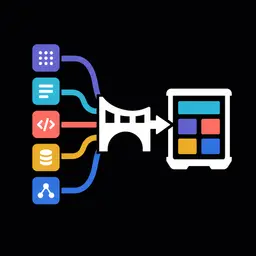

# Migrate Agents



Migrate Agents is a bundled Agent Zero plugin for bringing retained work
home from these agent harnesses:

- Pi
- OpenClaw
- Hermes Agent
- OpenCode
- Claude Code
- Codex

The plugin checks an export before importing it. You choose which chats,
projects, memories, instructions, and skills to bring into Agent Zero.
Credentials, authentication files, and hidden reasoning are excluded.

## Enable

Enable **Migrate Agents** in Plugins, then use its **Open** button.

For the screenshot walkthrough, see [Migrate chats into Agent Zero](../../docs/guides/migrate-agents.md).

## Prepare an export

| Source | Recommended input |
| --- | --- |
| Pi | Session `.jsonl` files from `~/.pi/agent/sessions/`, or your configured session directory; add `AGENTS.md` and skill folders separately |
| OpenClaw | `openclaw backup create --verify`, an agent SQLite snapshot, or legacy transcript JSONL |
| Hermes Agent | `hermes sessions export backup.jsonl --redact`, `~/.hermes/state.db`, or a folder/archive containing memories and skills |
| OpenCode | `opencode export <session-id> > session.json`, repeated for each session you want |
| Claude Code | A folder/archive from `~/.claude/projects`, plus any `CLAUDE.md` and skills you want |
| Codex | The `sessions/` and `archived_sessions/` folders beneath `CODEX_HOME` (normally `~/.codex`) |

You can choose individual files, a whole directory, ZIP, TAR, or TAR.GZ. The
preview is read-only. Import does not start until you review the manifest and
confirm it.

## Pi sessions and branches

Choose the original JSONL sessions, not `pi --export` HTML output. Pi session
versions 1, 2, and 3 are supported, including legacy headers without a version.
When Pi uses a custom agent or session directory, select the sessions from
that location instead.

Each retained branch becomes a separate chat with its original message order.
Shared ancestors appear in each branch; metadata-only branches do not create
duplicate chats. The latest non-empty session name and original workspace are
retained. Project creation does not copy that workspace's files.

Tool arguments, results, errors, and public shell activity become inert historical
records. They are never executed during import. Image content becomes a visible
omission marker; copy any needed files separately.

The import preserves retained original messages, rather than reconstructing Pi's
current model context. System prompts, reasoning, compaction and branch summaries,
context edits, extension records, and context-excluded shell commands are omitted.
The preview warns when such context records were skipped. An imported chat can
therefore be longer than Pi's compacted context and show text that a later context
edit removed from the model's view. Review it before continuing or sharing.

## What maps cleanly

| Source material | Agent Zero destination | Notes |
| --- | --- | --- |
| User and assistant messages | Native chats | Source ID, timestamps, and workspace metadata are retained when available. |
| Retained workspace paths | Native projects | Chats from the same retained workspace are attached to the same imported project. Project files are not reconstructed from transcript metadata alone. |
| Tool activity | Historical tool records | Sanitized and inert; never replayed as commands. |
| Memory Markdown | `usr/knowledge/_migrate_agents/<source>/memories/` | Each document receives a provenance header. |
| `SOUL.md`, `USER.md`, `CLAUDE.md`, `AGENTS.md`, and related instructions | `usr/knowledge/_migrate_agents/<source>/instructions/` | Instructions remain separately selectable from memories. |
| Agent Skills containing `SKILL.md` | `usr/skills/_migrate_agents/<source>/` | Complete skill folders are copied under unique names. |
| Attachment references | Chat metadata or text | Binary attachment copying is not automatic. |

## Deliberate privacy boundary

Migrate Agents never imports provider keys, credentials, authentication
state, channel bindings, schedules, hidden reasoning, or live services. It
redacts obvious secret assignments, bearer tokens, private keys, and embedded
data URLs from imported text and tool records. This is defense in depth, not a
guarantee; review migrated material before sharing it.

The Codex adapter follows the preservation and privacy rules of the
`convert-codex-chats` utility skill: public user/commentary/final events are
retained, tool calls and results are paired when available, encrypted or hidden
reasoning is excluded, and historical actions are not presented as replayable.

## Limits

- 5,000 expanded files per migration
- 100 MiB per file
- 256 MiB expanded total
- Preview lists are capped at 200 rows, while import still processes the full accepted bundle
- Pi sessions are limited to 100 tree leaves and 100,000 expanded entries per file; repeated ancestors count toward a 256 MiB branch-data limit across the upload. This conservative limit counts complete source entries, including content later omitted. Broken trees and unsupported versions are skipped with a warning. Fork smaller sessions in Pi or upload fewer files when a limit is reached.
- Modern OpenClaw conversation imports require its per-agent database or transcript artifacts; the global control-plane database does not contain chats

## Development

No third-party Python or JavaScript packages are required.

```bash
python -m pytest plugins/_migrate_agents/tests -q
```

Harness logo SVGs are bundled locally under `webui/assets/`; provenance and
license details are recorded in `webui/assets/ATTRIBUTION.md`.
